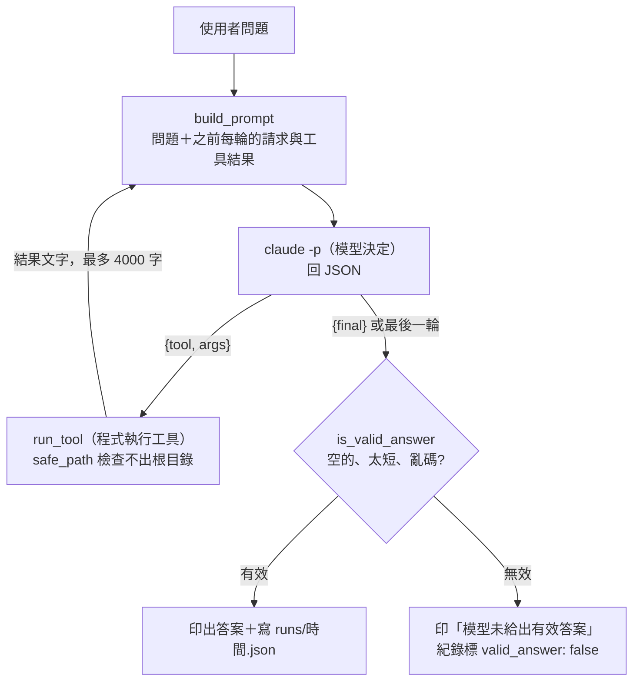

# S1 本機資料夾小管家 自己寫的最小代理迴圈

> K903《Claude Quickstarts 範例實作》第 1 段，共 5 段。對應官方 claude-quickstarts（K902）第 3 章 agents。
> 書號 9 開頭為自製教材，沒有原書；模型一律走 claude -p 轉接層，不設 API 金鑰。

## 導讀

S1 是五個範例的地基。它把官方 agents 專案的 while 迴圈縮成不到兩百行：模型想、要求工具、程式執行工具、把結果放回歷史、再問一次。差別在於模型改走 claude -p（訂閱額度、不設金鑰），工具改成三個只能讀的檔案工具，並且鎖在一個根目錄裡，最多跑五輪。這一段要學會三件事：權限是程式給的，不是模型自己有的；沒有記憶的模型靠每輪重送逐字稿撐起多輪對話；模型給的路徑一律不可信。

每個範例學完都要回答三個靈魂拷問：這個代理是做給誰用的？它被賦予了哪些工具的權限？它的資料和成果最後存在哪裡？

## 範例說明（README）

### 1. 模仿哪一章

模仿官方 claude-quickstarts 第 3 章 `agents`，講義在 `~/workspace/kindle-902-claude-quickstarts/lessons/ch03-agents.md`。

這個範例讓你在終端機用一句中文問 `~/workspace/console/shopping-notes/` 裡的比價紀錄。模型自己決定要列資料夾、搜尋關鍵字還是讀檔，讀到夠了就回答。

### 2. 三個靈魂拷問

| 問題 | 答案 |
| --- | --- |
| 這個代理是給誰用的？ | 給自己用。它查的是自己電腦上的筆記，例如「最近一次比價是什麼？推薦哪一款？」。在終端機一個人使用。 |
| 被賦予了哪些工具權限？ | **可以做的**：`list_dir`、`read_file`（最多 4000 字）、`search_text`，三個都只讀，範圍限定在一個根目錄（預設 shopping-notes，可用 `--root` 改）。路徑解析後若跑到根目錄外（`..`、`C:/Windows` 這類絕對路徑）就拒絕。<br>**刻意不給的**：寫檔、刪檔、執行指令、上網、寄信。`claude -p` 本身也用 `--tools ""` 關掉所有內建工具，所以模型只能回文字，真正動手讀檔的是我們的 Python 程式。 |
| 資料和成果最後存在哪裡？ | 答案只印在終端機。迴圈紀錄寫在 `s1-agent-loop/runs/<時間>.json`，內容有問題、答案、每一輪的請求、用了哪個工具、結果長度，**不存工具讀到的全文**。代理不寫其他任何檔案，`claude -p` 也加了 `--no-session-persistence`。 |

### 3. 架構與資料流



每次 `claude -p` 都是全新的行程，沒有記憶，所以每一輪都把「問題＋所有往來」重新攤平成一份逐字稿送進去。這就是官方 `history` 在做的事，只是這裡每次都重送全文。

### 4. 怎麼跑（Git Bash）

```bash
cd ~/workspace/kindle-903-quickstarts-samples/s1-agent-loop
PYTHONUTF8=1 python folder_agent.py "最近一次比價是什麼商品？推薦哪一款？"

# 換一個資料夾問
PYTHONUTF8=1 python folder_agent.py --root ~/workspace/console/life-notes "最近量了什麼？"
```

不需要任何 API 金鑰，前提是已經登入 Claude Code（Max 訂閱）。要換成較快的模型可以設 `K902_CLI_MODEL=haiku`。

想看「最後一輪強制作答」的行為，可以把輪數壓小：

```bash
PYTHONUTF8=1 python folder_agent.py --max-rounds 2 "shopping-notes 裡最近一次比價是什麼商品？推薦哪一款？"
```

實測（2026-11-25，2 次模型呼叫）：第 1 輪模型呼叫 `list_dir(".")`，第 2 輪給出答案，沒有把 shopping-notes 當成子資料夾。答案說明最新日期 11-25 有拉花鋼杯和鋁箔烤盤兩筆，並坦白還沒讀到推薦內容。

### 5. 實際跑出來的結果（2026-11-25 冒煙測試）

```text
第 1 輪：模型要求 list_dir({"path": "."}) → 結果 545 字，首行：2026-11-08-伯朗三合一咖啡/
第 2 輪：模型要求 list_dir({"path": "2026-11-25-latte-art-pitcher"}) → 結果 39 字，首行：original-1.jpg
第 3 輪：模型要求 read_file({"path": "2026-11-25-latte-art-pitcher/README.md", "max_chars": 3000}) → 結果 2009 字，首行：# 不鏽鋼拉花鋼杯（尖嘴奶泡杯）蝦皮 Top 5（2026-11-25）
第 4 輪：模型回覆最終答案

=== 答案 ===
最近一次比價（2026-11-25）是「不鏽鋼拉花鋼杯（尖嘴奶泡杯）」，在蝦皮比了 5 家不同店的 Top 5 ……
1. 想跟咖啡店那支最像：第 4 名「寶馬不銹鋼304拉花杯（無刻度）」，享樂生活百貨，$179～$330 ……
2. 銷量最穩又便宜：第 1 名卡特屋「304不鏽鋼拉花杯」，$69～$259 ……
另外，同一天（11-25）還有一筆「7 吋圓形鋁箔烤盤」的比價。如果你想看的是那一筆，我可以再幫你讀。

（模型呼叫 4 次，紀錄：…\s1-agent-loop\runs\20261125-141352.json）
real 0m22.1s
```

模型自己選擇先列目錄，再從日期判斷最新一筆，接著讀檔，總共 4 次呼叫。它還注意到同一天有兩筆比價，主動提醒。

錯誤處理也測過：

```text
$ PYTHONUTF8=1 python folder_agent.py --root ~/no-such-dir "測試"
錯誤：根目錄不存在或不是資料夾：%USERPROFILE%\no-such-dir      （exit 2，沒有呼叫模型）

run_tool(read_file, "../../.ssh/id_rsa") → 錯誤：拒絕存取根目錄以外的路徑：../../.ssh/id_rsa
run_tool(list_dir, "C:/Windows")         → 錯誤：拒絕存取根目錄以外的路徑：C:/Windows
```

### 6. 跟官方原版差在哪

| 項目 | 官方 `agents` | 本範例 |
| --- | --- | --- |
| 呼叫模型 | `anthropic` SDK＋`ANTHROPIC_API_KEY` | `claude -p`（shared/llm_agent.py），不設金鑰 |
| 工具協定 | API 原生 tool use（`tool_use`／`tool_result` block） | 用提示詞約定，模型回 `{"tool","args"}` 或 `{"final"}` JSON |
| 一輪幾個工具 | 可以多個，預設平行執行 | 一輪一個 |
| 結束條件 | 只有「模型不再要工具」，沒有最大輪數 | 同上，再加最多 5 輪（`--max-rounds` 可改）。最後一輪附上 `{"final": "<你的答案>"}` 範例，要求模型根據前面的工具結果作答 |
| 歷史管理 | `MessageHistory` 會依 context 上限截掉最舊的 | 每輪重送全文，工具結果每筆截到 4000 字 |
| 工具 | 本機工具＋MCP＋伺服器端工具 | 三個唯讀檔案工具，鎖在根目錄 |

正式上線要改：

- 改用 API 原生 tool use，才不會因為模型偶爾不照 JSON 格式而出錯。目前有兩道防呆。第一道：`parse_reply` 逐一嘗試回覆裡每個 `{`，取第一個含 `tool` 或 `final` 的物件，所以模型把 JSON 重複兩次也能解析。第二道：`is_valid_answer` 擋掉空答案、少於 8 字的答案、把格式說明抄回來的亂碼（實測遇過 `明、{"final":...}只輸出JSON。`）。被擋下時印出「模型未給出有效答案」，紀錄寫 `valid_answer: false` 並保留前 80 字原文，程式以 exit 3 結束。
- 每次重送全文會讓 token 越來越多，要做歷史截斷或摘要。
- 加重試與逾時處理、限制單一檔案大小。也要處理符號連結：`list_dir`／`read_file` 會先 `resolve()` 再檢查，連到根目錄外的連結會被拒絕；但 `search_text` 的 `rglob` 沒有逐檔檢查，根目錄內若有指向外面的檔案連結仍會被讀到。另外每次搜尋都要掃整個樹，資料夾大了會變慢。
- 紀錄改成結構化 log，並決定保存多久。

### 7. 模仿指南：改成自己的需求，改這 3 個地方

1. **`DEFAULT_ROOT`**：換成你想讓它管的資料夾，例如 `Path.home() / "Documents" / "食譜"`。
2. **`TOOLS` 與對應函式**：加入你需要的唯讀工具，例如 `count_files`、`read_csv_rows`。每個工具第一行都要先呼叫 `safe_path()`。
3. **`SYSTEM_PROMPT`**：改掉代理的角色和工具清單說明。新增的工具一定要寫進去，模型才知道可以用。

## 逐步演練教練稿（8 步）

K903 範例 S1 互動演練：本機資料夾小管家，自己寫的最小工具迴圈（教練稿）

【第 1 步：這個範例模仿官方第 3 章的什麼】
S1 模仿的是官方第三章的 agents。官方的代理就是一個 while True 迴圈：呼叫模型，有工具要求就執行，把結果放回歷史，再呼叫一次。S1 把同一個迴圈縮成不到兩百行，模型改走 claude 減 p，不設任何金鑰，工具換成三個只能讀的檔案工具。畫面上的對照表一共七項，最大的差別有兩個：工具呼叫改成模型回一段 JSON，還有最多只跑五輪。目的，是先知道 S1 是官方迴圈的縮小版，哪裡一樣、哪裡刻意簡化。

【第 2 步：看工具定義，三個唯讀工具都鎖在根目錄】
第二步看工具。工具其實就是兩樣東西：寫進系統提示的一段說明，加上一個 Python 函式。模型只看得到說明，真正去讀檔的是我們的程式，因為 claude 減 p 加了「工具清單是空的」這個旗標，模型自己什麼都不能做。每個工具都先經過 safe path 這個守門員，它把路徑解析成絕對路徑，不在根目錄底下就拒絕。最後離線列一次根目錄，裡面有二十幾筆比價紀錄。目的，是看懂權限是程式給的，不是模型自己有的。

【第 3 步：看迴圈主程式】
第三步看迴圈本身，只有十幾行。每一輪先組提示詞、問模型；模型回 final 就結束，回工具名稱就執行工具，把結果記下來再進下一輪。因為每次 claude 減 p 都是全新的行程，沒有記憶，所以每一輪都要把問題和之前所有的往來，攤平成一份逐字稿重送。畫面示範第二輪的逐字稿長什麼樣子，這就是官方 history 在做的事。目的，是看懂「沒有記憶的模型」怎麼靠重送全文撐起多輪對話。

【第 4 步：實跑一題】
第四步會呼叫真的模型，最多兩次，大約等十幾秒。題目是「最新的一筆比價是哪一天、什麼商品」，看資料夾名稱就答得出來。第一次模型應該要求列根目錄，第二次就回答。為了守住本章兩次的預算，這一步把最多輪數設成二，第二輪就是最後一輪，提示詞會要求模型直接作答、不能再用工具。如果答案是空的、太短，或把格式說明抄回來，程式會擋下來，照實顯示「模型未給出有效答案」。目的，是親眼看到模型自己決定用哪個工具，再根據結果回答。

【第 5 步：看 runs 資料夾的 JSON 紀錄】
第五步不呼叫模型，讀上一步存下來的紀錄。紀錄有問題、答案、呼叫次數、耗時，還有每一輪要求了什麼工具、結果有幾個字。要注意的是刻意沒存的東西：工具讀到的全文不存，避免把私人筆記再複製一份。根目錄欄位存的是本機絕對路徑，所以整個 runs 資料夾不進版控。目的，是學會設計紀錄時，先想清楚哪些該記、哪些不該記。

【第 6 步：試路徑跳脫】
第六步離線丟八個請求給工具執行函式。根目錄本身和裡面的子資料夾可以讀；用點點往上跳、Windows 和 Unix 的絕對路徑、先進去再跳出來，全部被擋。要一個不存在的工具、參數名稱寫錯，也都變成錯誤文字回給模型，程式不會當掉。最後照實說一個已知漏洞：搜尋工具掃整棵樹時沒有逐檔檢查，根目錄裡如果有指向外面的連結，還是會被搜到。目的，是記住模型給的路徑一律不可信。

【第 7 步：換一個自己的問題或根目錄】
第七步不呼叫模型，看換根目錄的機制。改成生活紀錄資料夾後，列目錄和搜尋「溫度」都只看得到那個資料夾，原本的比價資料夾反而變成跳脫被擋。接著真的執行一次，給一個不存在的根目錄，程式在呼叫模型之前就結束，代碼是二。畫面最後印出指令，演練結束後你可以換自己的題目跑，那會再花兩到五次呼叫。目的，是知道換資料夾只要改一個參數，權限範圍跟著一起換。

【第 8 步：三個靈魂拷問】
最後一步分兩半。前半只出題，不給答案：這個代理給誰用、有哪些工具權限、資料和成果存在哪裡。請你先自己各用一兩句話回答，說完再說「繼續」。後半才顯示範例答案，直接從範例的說明文件讀出來；再列出如果改成給客戶用，三題會怎麼變：使用者變成外部客戶，要登入、限流、擋提示詞注入；根目錄要換成只放公開文件的資料夾，還要補搜尋漏洞；紀錄要去識別化、定保存期限，模型也要改用伺服器上的 API，不能再用個人訂閱。目的，是看懂 S1 安全，是因為使用者、資料擁有者、受影響的人都是自己；三者一分開，權限和紀錄就要重新設計。

## 主要程式碼

### s1-agent-loop/folder_agent.py

```python
"""S1 本機資料夾小管家：模仿 claude-quickstarts 第 3 章 agents 的最小工具迴圈。

做什麼：使用者用自然語言問某個資料夾（預設 ~/workspace/console/shopping-notes）裡的內容，
模型自己決定要呼叫 list_dir／read_file／search_text 哪個工具、呼叫幾次，最後給出答案。

為什麼不用 anthropic SDK：K903 規定不設 API 金鑰，模型一律走 claude -p（shared/llm_agent.py）。
原生 tool use 改成「模型回 JSON」：{"tool": 名稱, "args": {...}} 或 {"final": 答案}。

用法（Git Bash）：
    PYTHONUTF8=1 python folder_agent.py "最近一次比價是什麼商品？推薦哪一款？"
    PYTHONUTF8=1 python folder_agent.py --root ~/某資料夾 "問題"
"""
from __future__ import annotations

import argparse
import json
import sys
import time
from datetime import datetime
from pathlib import Path

sys.path.insert(0, str(Path(__file__).resolve().parents[1] / "shared"))
from llm_agent import run_claude

MAX_ROUNDS = 5
DEFAULT_ROOT = Path.home() / "workspace" / "console" / "shopping-notes"
RUNS_DIR = Path(__file__).resolve().parent / "runs"
TEXT_SUFFIXES = {".md", ".txt", ".json", ".csv"}
# 工具結果太長會讓下一輪提示詞爆量，每筆最多回給模型這麼多字
RESULT_LIMIT = 4000
# 最終答案少於這個字數，多半是模型把格式說明複述一次的殘渣，不當成答案
MIN_ANSWER_CHARS = 8
INVALID_ANSWER = "模型未給出有效答案"
# 模型把提示詞裡的格式說明抄回來時會出現這些片段（實測：`明、{"final":...}只輸出JSON。`）
ECHO_MARKERS = ('{"final"', '{"tool"', "只輸出JSON", "只輸出 JSON", "<你的答案>")
MAX_SEARCH_HITS = 30

SYSTEM_PROMPT = """你是「本機資料夾小管家」，只能透過工具讀取一個資料夾來回答使用者的問題。
根目錄就是「{root_name}」資料夾本身，路徑一律用相對於根目錄的寫法（根目錄本身是 "."）。
使用者提到「{root_name}」時指的是根目錄，不要把它當成子資料夾。

可用工具（全部唯讀）：
- list_dir   args: {"path": "相對路徑"}               列出資料夾內容（資料夾結尾有 /）
- read_file  args: {"path": "相對路徑", "max_chars": 整數}  讀文字檔前 max_chars 字（預設 3000）
- search_text args: {"keyword": "關鍵字"}              在所有文字檔中找含關鍵字的行

每一輪你只能輸出「一個 JSON 物件」，不要任何其他文字：
- 要用工具：{"tool": "工具名稱", "args": {...}}
- 可以回答了：{"final": "給使用者的繁體中文答案"}
不要自己編造工具結果；答案要根據工具讀到的內容。"""


class PathEscapeError(ValueError):
    """路徑解析後跑到根目錄外面（例如用 .. 跳脫）。"""


# ---------- 工具（全部唯讀，且限制在 root 底下） ----------

def safe_path(root: Path, rel: str) -> Path:
    """把相對路徑解析成絕對路徑；解析後不在 root 底下就拒絕，防 .. 與絕對路徑跳脫。"""
    target = (root / (rel or ".")).resolve()
    if target != root and root not in target.parents:
        raise PathEscapeError(f"拒絕存取根目錄以外的路徑：{rel}")
    return target


def list_dir(root: Path, path: str = ".") -> str:
    target = safe_path(root, path)
    if not target.is_dir():
        return f"錯誤：{path} 不是資料夾"
    names = [p.name + ("/" if p.is_dir() else "") for p in sorted(target.iterdir())]
    return "\n".join(names) or "（空資料夾）"


def read_file(root: Path, path: str, max_chars: int = 3000) -> str:
    target = safe_path(root, path)
    if not target.is_file():
        return f"錯誤：{path} 不是檔案"
    text = target.read_text(encoding="utf-8", errors="replace")
    limit = max(1, min(int(max_chars), RESULT_LIMIT))
    suffix = f"\n…（已截斷，全文 {len(text)} 字）" if len(text) > limit else ""
    return text[:limit] + suffix


def search_text(root: Path, keyword: str) -> str:
    if not keyword or not keyword.strip():
        return "錯誤：keyword 是空的"
    needle = keyword.lower()
    hits: list[str] = []
    for file in sorted(root.rglob("*")):
        if not file.is_file() or file.suffix.lower() not in TEXT_SUFFIXES:
            continue
        lines = file.read_text(encoding="utf-8", errors="replace").splitlines()
        for number, line in enumerate(lines, 1):
            if needle in line.lower():
                hits.append(f"{file.relative_to(root).as_posix()}:{number}: {line.strip()[:200]}")
                if len(hits) >= MAX_SEARCH_HITS:
                    return "\n".join(hits) + f"\n…（只列前 {MAX_SEARCH_HITS} 筆）"
    return "\n".join(hits) or f"找不到含「{keyword}」的行"


TOOLS = {"list_dir": list_dir, "read_file": read_file, "search_text": search_text}


def run_tool(root: Path, name: str, args: dict) -> str:
    """執行模型要求的工具；任何錯誤都變成文字回給模型，讓它自己換做法，而不是讓程式當掉。"""
    func = TOOLS.get(name)
    if func is None:
        return f"錯誤：沒有叫 {name} 的工具，可用：{', '.join(TOOLS)}"
    try:
        return func(root, **(args or {}))
    except PathEscapeError as exc:
        return f"錯誤：{exc}"
    except (TypeError, ValueError) as exc:
        return f"錯誤：參數不對（{exc}）"
    except OSError as exc:
        return f"錯誤：讀取失敗（{exc}）"


# ---------- 代理迴圈 ----------

def build_system(root: Path) -> str:
    """系統提示帶入根目錄名稱：題目寫到資料夾名稱時，模型才不會把它當成子資料夾去列。"""
    return SYSTEM_PROMPT.replace("{root_name}", root.name)


def build_prompt(question: str, steps: list[dict], is_last: bool) -> str:
    """每次 claude -p 都是全新行程，所以要把問題和所有工具往來攤平成一份逐字稿送進去。"""
    parts = [f"使用者的問題：{question}"]
    for step in steps:
        parts.append(f"[第 {step['round']} 輪] 你要求：{json.dumps(step['request'], ensure_ascii=False)}\n"
                     f"工具結果：\n{step['result'][:RESULT_LIMIT]}")
    if is_last:
        # 給完整範例而不是「...」：模型看到省略號時常把格式說明本身抄成答案
        parts.append("這是最後一輪，不能再呼叫工具。請根據上面各輪的工具結果回答使用者的問題；"
                     "資料不足就說明目前查到什麼、還缺什麼。\n"
                     "整個回覆只能是一個 JSON 物件，格式如下（把角括號那段換成你的繁體中文答案）：\n"
                     '{"final": "<你的答案>"}')
    else:
        parts.append("請輸出下一步的 JSON。")
    return "\n\n".join(parts)


def parse_reply(reply: str) -> dict:
    """找回覆裡第一個含 tool 或 final 的 JSON 物件。

    為什麼不用 extract_json：它取第一個 { 到最後一個 }，模型把同一個 JSON 重複兩次
    （實測：外面多包一層標籤再重寫一次）時，會把兩段黏在一起而解析失敗。
    """
    decoder = json.JSONDecoder()
    for start in (i for i, ch in enumerate(reply) if ch == "{"):
        try:
            obj, _ = decoder.raw_decode(reply, start)
        except json.JSONDecodeError:
            continue
        if isinstance(obj, dict) and ("tool" in obj or "final" in obj):
            return obj
    # 完全沒有 JSON 時把整段文字當答案，交給 is_valid_answer 把關
    return {"final": reply.strip()}


def ask_model(prompt: str, system: str) -> dict:
    """呼叫一次模型並解析出這一輪的請求。"""
    return parse_reply(str(run_claude(prompt, system=system).get("result", "")))


def is_valid_answer(answer: object) -> bool:
    """擋掉空答案、太短的殘渣、把格式說明抄回來的亂碼。"""
    if not isinstance(answer, str):
        return False
    text = answer.strip()
    return len(text) >= MIN_ANSWER_CHARS and not any(marker in text for marker in ECHO_MARKERS)


def finish(round_no: int, request: dict, steps: list[dict]) -> tuple[str, list[dict], bool]:
    """收尾一輪 final：無效答案不往下傳，只在紀錄留前 80 字原文方便除錯。"""
    raw = request.get("final")
    valid = is_valid_answer(raw)
    print(f"第 {round_no} 輪：模型回覆最終答案" + ("" if valid else f"，但{INVALID_ANSWER}"))
    entry = {"round": round_no, "request": {"final": "..."}, "tool": None, "result_chars": 0, "valid_answer": valid}
    if not valid:
        entry["raw_final"] = str(raw)[:80]
    steps.append(entry)
    return (str(raw).strip() if valid else INVALID_ANSWER), steps, valid


def agent_loop(root: Path, question: str, max_rounds: int = MAX_ROUNDS) -> tuple[str, list[dict], bool]:
    steps: list[dict] = []
    system = build_system(root)
    for round_no in range(1, max_rounds + 1):
        request = ask_model(build_prompt(question, steps, is_last=round_no == max_rounds), system)
        if "final" in request:
            return finish(round_no, request, steps)
        name, args = str(request.get("tool")), request.get("args") or {}
        result = run_tool(root, name, args if isinstance(args, dict) else {})
        first_line = result.splitlines()[0][:60] if result else ""
        print(f"第 {round_no} 輪：模型要求 {name}({json.dumps(args, ensure_ascii=False)}) "
              f"→ 結果 {len(result)} 字，首行：{first_line}")
        steps.append({"round": round_no, "request": request, "tool": name,
                      "result": result, "result_chars": len(result)})
    print(f"已達最多 {max_rounds} 輪，{INVALID_ANSWER}")
    return INVALID_ANSWER, steps, False


def save_run(root: Path, question: str, answer: str, steps: list[dict], seconds: float, valid: bool) -> Path:
    """迴圈紀錄只存每輪的請求、工具、結果長度，不存工具結果全文（避免把私人筆記複製一份）。"""
    RUNS_DIR.mkdir(exist_ok=True)
    out = RUNS_DIR / f"{datetime.now().astimezone():%Y%m%d-%H%M%S}.json"
    record = {
        "question": question, "root": str(root), "answer": answer, "valid_answer": valid,
        "model_calls": len(steps), "seconds": round(seconds, 1),
        "rounds": [{k: v for k, v in s.items() if k != "result"} for s in steps],
    }
    out.write_text(json.dumps(record, ensure_ascii=False, indent=2), encoding="utf-8")
    return out


def to_local_path(raw: str) -> Path:
    """Git Bash 設了 MSYS_NO_PATHCONV=1 時，~ 會展開成 /c/Users/...，Windows Python 看不懂，要轉回 C:/..."""
    if sys.platform == "win32" and len(raw) >= 3 and raw[0] == "/" and raw[2] == "/" and raw[1].isalpha():
        raw = f"{raw[1]}:{raw[2:]}"
    return Path(raw).expanduser().resolve()


def main() -> int:
    parser = argparse.ArgumentParser(description="本機資料夾小管家（唯讀工具迴圈，模型走 claude -p）")
    parser.add_argument("question", help="要問的問題")
    parser.add_argument("--root", default=str(DEFAULT_ROOT), help="只允許讀取的根目錄")
    parser.add_argument("--max-rounds", type=int, default=MAX_ROUNDS, help=f"最多幾輪（預設 {MAX_ROUNDS}）")
    opts = parser.parse_args()
    if opts.max_rounds < 1:
        print("錯誤：--max-rounds 至少要 1", file=sys.stderr)
        return 2
    root = to_local_path(opts.root)
    if not root.is_dir():
        print(f"錯誤：根目錄不存在或不是資料夾：{root}", file=sys.stderr)
        return 2
    started = time.time()
    try:
        answer, steps, valid = agent_loop(root, opts.question, opts.max_rounds)
    except RuntimeError as exc:
        print(f"錯誤：呼叫模型失敗：{exc}", file=sys.stderr)
        return 1
    log_path = save_run(root, opts.question, answer, steps, time.time() - started, valid)
    print(f"\n=== 答案 ===\n{answer}\n\n（模型呼叫 {len(steps)} 次，紀錄：{log_path}）")
    return 0 if valid else 3


if __name__ == "__main__":
    sys.exit(main())
```
