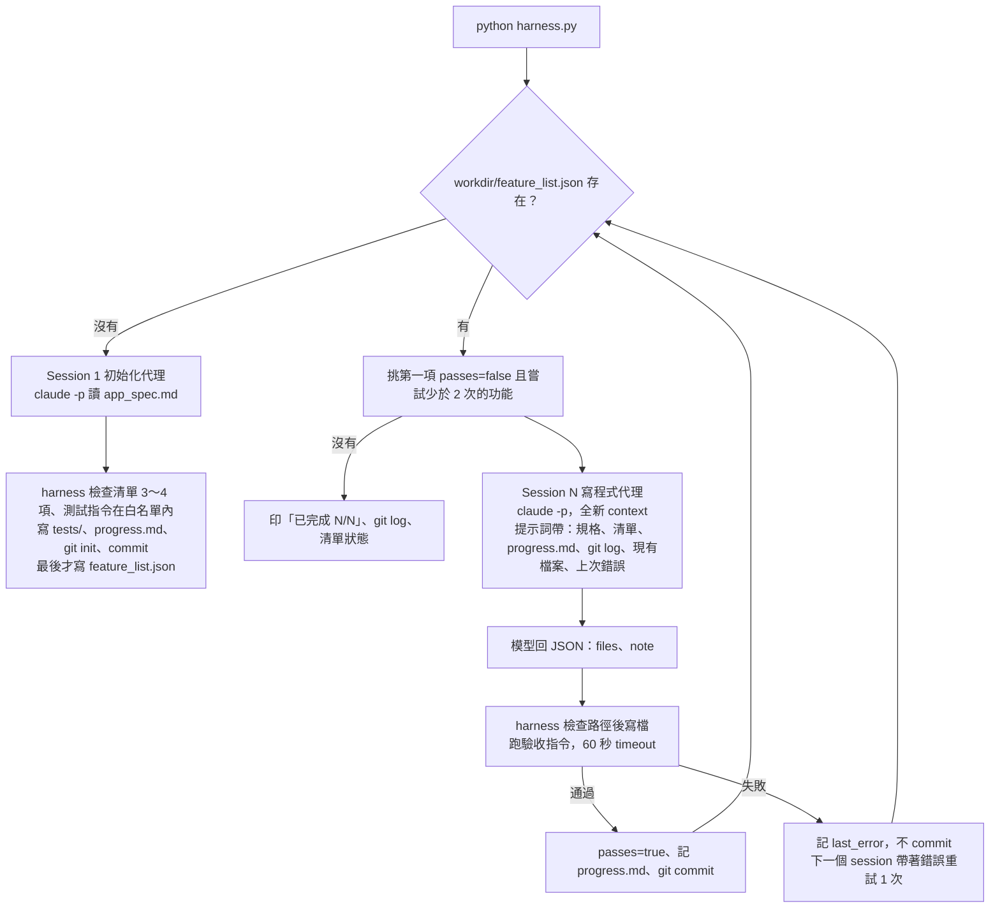

# S3 兩階段自動寫程式 規劃與實作接力的長時間任務

> K903《Claude Quickstarts 範例實作》第 3 段，共 5 段。對應官方 claude-quickstarts（K902）第 10 章 autonomous-coding。
> 書號 9 開頭為自製教材，沒有原書；模型一律走 claude -p 轉接層，不設 API 金鑰。

## 導讀

S3 模仿官方 autonomous-coding 的兩階段做法：第一個 session 當規劃者，把需求拆成功能清單與測試；之後每個 session 當實作者，一次完成一個功能、跑測試、commit，再把進度寫進進度檔，讓下一個 session 接手。模型只回 JSON，寫檔、跑測試、commit 全由 harness 代做。這一段要學會長時間任務的三個關鍵：進度檔與功能清單是交接單、續跑要能從中斷處接上、停止條件要寫死（最多呼叫模型幾次）。

每個範例學完都要回答三個靈魂拷問：這個代理是做給誰用的？它被賦予了哪些工具的權限？它的資料和成果最後存在哪裡？

## 範例說明（README）

### 1. 模仿官方哪一章

- 對應官方 `claude-quickstarts/autonomous-coding`，導讀在 K902 講義 `~/workspace/kindle-902-claude-quickstarts/lessons/ch10-autonomous-coding.md`。
- 一句話：初始化代理把 `app_spec.md` 切成 3～4 項功能並寫好驗收測試，寫程式代理每個 session 只做一項，harness 驗收、commit、記筆記，中斷後重跑同一條指令就接著做。

### 2. 三個靈魂拷問

| 問題 | 回答 |
| --- | --- |
| 這個代理是給誰用的？ | 給想學「長時間任務怎麼拆成很多個 session 接力」的自己。產出的 `ledger.py` 是給自己記帳用的小工具，不對外。 |
| 被賦予了哪些工具的權限？ | **可以做的**：回一段 JSON，寫明要寫哪些檔案、內容是什麼。寫檔、跑測試、commit 都由 harness 代做。<br>**刻意不給的**：模型本身沒有任何工具（`claude -p --tools ""`），不能自己讀檔、跑指令或上網。harness 只准寫進 `workdir/` 內，會擋 `..`、絕對路徑、`.git/`。`feature_list.json`、`progress.md` 只有 harness 能寫，模型不能改清單或把功能標成通過。寫程式代理不能改 `tests/`，所以沒辦法改測試讓自己過關。驗收指令只接受 `python -m unittest …` 或 `python <檔>.py` 兩種格式，不經過 shell，60 秒 timeout。一次執行最多呼叫模型 10 次。 |
| 資料和成果最後存在哪裡？ | 全部在 `s3-long-running/workdir/`，它是一個獨立的 git repo：`feature_list.json`（功能清單與狀態）、`progress.md`（每個 session 的交接筆記）、`tests/`、`ledger.py`，以及 git 歷史。外層 repo 的 `.gitignore` 排除 `workdir/`，所以成果不進教材的版控。 |

### 3. 架構與資料流



session 之間唯一的橋樑是 `workdir/` 裡的三樣東西：`feature_list.json` 記錄還剩哪些功能，`progress.md` 記錄上一個 session 做了什麼，git 歷史是可以回復的存檔點。這和官方原版的設計一樣。

### 4. 怎麼跑（Git Bash）

```bash
cd ~/workspace/kindle-903-quickstarts-samples/s3-long-running
PYTHONUTF8=1 python harness.py --selftest          # 離線檢查路徑與指令白名單，不呼叫模型
rm -rf workdir                                      # 想從頭來才需要
PYTHONUTF8=1 python harness.py                      # 預設跑 3 個 session，--max-calls 預設 10
PYTHONUTF8=1 python harness.py                      # 再跑一次同一條指令＝續跑
PYTHONUTF8=1 python workdir/ledger.py my.csv        # 用代理寫出來的工具
```

**新電腦先看這裡**：`workdir/` 被外層 `.gitignore` 排除，clone 下來時不存在。要演練或查看 4/4 完成版，不必重跑 harness（不呼叫模型），從進版控的快照 `snapshot-4of4/` 重建即可：

```bash
cd ~/workspace/kindle-903-quickstarts-samples/practice/interactive
bash s3.sh seed      # 複製 snapshot-4of4 → workdir，git init，用一個 commit 提交（workdir 已存在就什麼都不做）
```

不跑 seed 也行：互動演練的第 3、4、7 步與 `restore` 發現 workdir 和 `workdir.bak-4of4` 都不存在時會自動重建。重建出來的 workdir 只有 1 個 commit，原本的 5 個 commit 記在 `snapshot-4of4/git-log.txt`。第 7 步用的測試資料是進版控的 `sample.csv`。

參數說明：`--max-sessions N` 指定這次最多跑幾個 session，`--max-calls N` 指定這次最多呼叫模型幾次，`--workdir PATH` 指定產出資料夾。模型用 Claude Code 的預設模型，要換就設 `K902_CLI_MODEL=haiku`。

### 5. 實際跑出來的結果（2026-11-25 冒煙測試，節錄）

第 1 次，從空的 workdir 開始，預設 3 個 session，約 2 分鐘：

```text
Session 1：初始化代理（讀規格 → 產出功能清單與驗收測試）
  → 功能 4 項：F1, F2, F3, F4 → commit 41e2f99
Session 2：處理功能 F1 load_records(path)：以 UTF-8 讀取 date,category,amount 格式的 CSV，…
  → 測試結果：通過 → commit b35e7bf
Session 3：處理功能 F2 sum_by_category(records) 依分類加總金額、sum_by_month(records) 依 YYYY-MM 加總金額，…
  → 測試結果：通過 → commit 78acf24

本次模型呼叫：3 次（上限 10）
== feature_list.json 狀態 ==
  F1   PASS     嘗試 1 次  load_records(path)：…
  F2   PASS     嘗試 1 次  sum_by_category(records) …
  F3   TODO     嘗試 0 次  format_report(records)：…
  F4   TODO     嘗試 0 次  CLI：執行 python ledger.py <csv 路徑> …
```

第 2 次，同一條指令，從 Session 4 接著做，約 35 秒：

```text
Session 4：處理功能 F3 format_report(records)：組出報表文字，…
  → 測試結果：通過 → commit dd919db
Session 5：處理功能 F4 CLI：執行 python ledger.py <csv 路徑> 會把報表印到 stdout，…
  → 測試結果：通過 → commit a1bc69b
沒有可做的功能了：已完成 4/4 項

本次模型呼叫：2 次（上限 10）
== git log --oneline ==
a1bc69b 完成 F4：CLI：…
dd919db 完成 F3：format_report(records)：…
78acf24 完成 F2：…
b35e7bf 完成 F1：…
41e2f99 初始化：功能清單、驗收測試、進度筆記
```

第 3 次再跑，不呼叫模型，直接印出 `沒有可做的功能了：已完成 4/4 項`。

代理寫出來的工具實際跑一次（測試資料第 5 列是故意放的壞列）：

```text
$ python workdir/ledger.py sample.csv
警告：第 5 列日期不合法，已略過：'bad'
== 各分類合計 ==
交通    35.00
餐飲    205.50
== 每月總計 ==
2026-10    155.00
2026-11    85.50
總計    240.50
```

兩次執行合計呼叫模型 5 次（初始化 1 次加上 4 項功能各 1 次），4 項功能都是第一次就通過。所以「失敗後帶錯誤重試」的路徑在這次冒煙測試中**沒有被觸發**。

### 6. 跟官方原版差在哪

| 項目 | 官方 autonomous-coding | 本範例 |
| --- | --- | --- |
| 模型怎麼呼叫 | Claude Agent SDK，要 `ANTHROPIC_API_KEY` | `claude -p`（Max 訂閱），透過 `shared/llm_agent.py`，不設任何金鑰 |
| 模型的權限 | 有 Read、Write、Bash 和 Puppeteer，靠沙箱、`./**` 權限限制和 Bash 允許清單 hook 約束 | 模型沒有任何工具，只回 JSON，寫檔和跑指令都由 harness 代做 |
| 功能清單防竄改 | 只靠提示詞（講義陷阱 2） | 清單只有 harness 能寫，模型也不能改 `tests/` |
| 何時停 | 只看 `--max-iterations`，沒有判斷全部完成（陷阱 1） | 全部通過就停；另有 `--max-calls` 呼叫上限 |
| 重試 | 出錯就開新 session，次數不限（陷阱 4） | 同一項最多重試 1 次，用完標成 GAVE-UP 並跳過 |
| 初始化寫一半被中斷 | 會被當成接續（陷阱 6） | `feature_list.json` 最後才寫，而且先寫暫存檔再改名 |
| 規模 | 200 項功能、網頁應用、瀏覽器驗證 | 4 項功能、CLI、unittest 驗證 |

**正式上線要改什麼**：

1. 驗收指令要放進真正的沙箱，例如容器或低權限帳號。目前只過白名單，被測的 Python 程式本身仍然能存取整台電腦。
2. 每個 session 要先重測已通過的功能，也就是官方第 3 步的回歸測試，否則後面的修改可能弄壞前面已通過的功能而沒人發現。
3. 專案變大後，不能再把所有檔案塞進提示詞，要改成讓模型用工具按需讀檔。目前上限 4 萬字，超過的部分會省略。
4. 初始化代理寫的測試要先由人審過一次。測試寫錯的話，後面的功能永遠過不了，或者會用錯的行為過關。
5. 失敗的修改目前留在工作區、沒有 commit。正式版應該在每次嘗試前開分支，失敗就丟掉。

### 7. 模仿指南：改成自己的需求，改這 3 個地方

1. **`app_spec.md`**：換成你要的工具規格。一定要寫清楚「介面」那一段（檔名、函式名、輸出格式），因為測試和實作是由不同的 session 寫的，靠這段對齊。
2. **`harness.py` 的 `INIT_PROMPT`，以及 `validate_features` 的 3～4 項限制**：改切分方式、功能數量、測試框架。換測試框架時，`parse_test_command` 的白名單也要一起放寬。
3. **`harness.py` 的 `CODE_PROMPT`**：改寫程式代理的規則，例如允許的套件、程式風格、交接筆記要寫什麼。

## 逐步演練教練稿（8 步）

K903 範例 S3 互動演練：兩階段自動寫程式，讓代理接力寫出記帳小工具（教練稿）

【開始前：新電腦先重建產出資料夾】
產出資料夾不進教材的版控，所以新電腦剛 clone 下來時沒有它。先執行 bash s3.sh seed，從快照資料夾把四項完成的版本複製回來，重新建一個 git，再用一個 commit 存起來，不會呼叫模型。不先跑也沒關係，第三、四、七步和還原指令發現資料夾不在，會自動重建。差別只有一個：重建出來的 git 紀錄只有一筆，所以第三步會改顯示快照裡保存的原本五筆紀錄。

【第 1 步：長時間工作的難處】
S3 模仿的是官方第十章的長時間自主寫程式。叫代理一口氣寫完一個專案，會出三種事：第一，對話越來越長，context 會滿；第二，跑到一半當機或被限流，狀態全丟，只能重來；第三，代理會自我放水，自己說做好了，甚至改測試讓自己過關。官方的解法是「兩階段，加進度檔，加 git」：第一階段由初始化代理把規格切成幾項功能、先寫好驗收測試；第二階段由寫程式代理每個 session 只做一項。表格把三個難處對到 S3 的做法。差別是官方用 Agent SDK 和 API 金鑰，模型自己能讀寫檔案；S3 走 claude 減 p，模型沒有任何工具，只回一段 JSON。目的，是先知道為什麼長時間任務要拆成很多個 session 接力。

【第 2 步：看規格和兩階段結構】
第二步只讀檔，不呼叫模型。規格檔是唯一的需求來源，最重要的是「介面」那一段：檔名、函式名、輸出格式都寫死，因為測試和程式由不同的 session 寫，靠這一段對齊。接著看 harness 的四個函式和行號：初始化、挑功能、寫程式，還有外層的 run。run 只有二十行，每一圈只做一個判斷：功能清單不存在就初始化，存在就挑下一項還沒過的功能；全部過了就停。目的，是看懂兩階段其實就是外層迴圈裡的一個 if。

【第 3 步：跨 session 的記憶就是三個檔】
第三步讀現在的產出資料夾，演練前是四項全部完成的版本。寫程式代理每次都是全新的 context，對上一棒一無所知，它知道進度全靠三樣東西：功能清單說還剩什麼，進度筆記說上一棒做了什麼、留了什麼提醒，git 紀錄是每通過一項就存一次的存檔點。如果資料夾是從快照重建的，git 紀錄只有一筆，畫面會說明原因，改列出快照保存的原本五筆。畫面最後，harness 根據這三樣東西推算出下一個是第六個 session，但已經沒有功能可做，所以重跑也不會呼叫模型。目的，是記住「記憶不在模型裡，在檔案裡」。

【第 4 步：權限護欄】
第四步不呼叫模型，先跑 harness 自帶的自我測試，結束碼零代表規則都正常。接著逐項測給你看：寫一般程式檔可以放行；往上跳出資料夾、絕對路徑、git 內部檔都擋；功能清單和進度筆記只有 harness 能寫；寫程式代理想改測試檔也擋。驗收指令只接受兩種 python 格式，裝套件、執行任意程式碼、用分號串指令、改用 bash，通通擋下。另外還有三道：同一項最多試兩次、整次執行有呼叫上限、清單先寫暫存檔再改名，中斷也不會留下寫一半的檔案。目的，是看懂模型能做的只有「提議寫哪些檔」，真正動手的是 harness。

【第 5 步：實跑示範，從零開始】
第五步會呼叫真的模型兩次，大約一到兩分鐘。腳本先把四項完成的資料夾改名備份，不會刪掉，再從空的資料夾跑兩個 session。第一個 session，初始化代理讀規格，切出功能清單、寫好測試，然後第一次 commit；第二個 session，寫程式代理做第一項讀檔功能，harness 跑測試，通過才 commit。結束時畫面會列出清單狀態，應該是一項通過、其餘待做。如果結束碼是一，代表 claude 減 p 失敗或被擋，要照實說明。目的，是親眼看到兩個階段各做了什麼。

【第 6 步：中斷後續跑】
上一步跑完兩個 session 就停了，等於被中斷。第六步什麼都不改，同一條指令再跑一次，最多再呼叫模型兩次。harness 從進度筆記數出下一個是第三個 session，從清單挑出第二項，做完再做第三項。第四項命令列功能這次留著沒做，因為本章的模型預算四次到這裡用完；這正好說明續跑的意義：下次再跑同一條指令，它就會接著做第四項，不必從頭來。目的，是看到「中斷了也不怕」靠的就是第三步那三個檔。

【第 7 步：跑代理寫出來的工具】
第七步不呼叫模型。剛剛演練的資料夾還沒做到命令列功能，所以這一步改用四項完成的備份版。用測試資料跑一次，第五列是故意放的壞列，會印一行警告並略過；報表和規格裡的範例輸出逐行比對，完全一致。接著跑全部十八個驗收測試，全部通過，只要有測試沒過，這一步的結束碼就是一；再給一個不存在的檔案，程式印錯誤訊息、結束碼是一，而且沒有露出程式內部的錯誤堆疊，符合規格。目的，是確認代理接力寫出來的東西，真的照規格能用。

【第 8 步：三個靈魂拷問】
最後一步分兩半。前半只出題：這個代理給誰用、有哪些工具權限、資料和成果存在哪裡。請你先各用一兩句話回答，特別想一下：它設計成可以沒人看著跑好幾個小時，那權限該比有人看著時鬆還是嚴？說完再說「繼續」。後半顯示範例答案：給自己學習用；模型沒有任何工具，只回 JSON，寫檔、跑測試、commit 都由 harness 代做；成果全部在獨立的 git 資料夾，不進教材的版控。接著說明為什麼無人看著要特別嚴格：出錯沒人喊停、額度可能一晚燒光、改測試放水沒人抓、半夜當機留下壞掉的狀態，而提示詞的叮嚀模型偶爾不聽。有人看著時，人是最後一道護欄；沒人看著時，程式就是唯一的護欄。最後會問要不要把資料夾還原成演練前四項完成的備份，也可以之後再執行還原指令。目的，是記住讓代理長時間自己跑之前，每一道護欄都要寫進程式。

## 主要程式碼

### s3-long-running/harness.py

```python
"""S3 兩階段自動寫程式 harness（模仿官方 claude-quickstarts/autonomous-coding）。

第 1 階段：初始化代理讀 app_spec.md，產出 workdir/feature_list.json、驗收測試檔、progress.md，git init＋第一個 commit。
第 2 階段：寫程式代理每個 session 只做一項未完成功能；模型只回 JSON（檔名＋內容），
          寫檔、跑測試、改 passes、commit 全由 harness 負責。
可續跑：所有狀態都在 workdir 的檔案與 git 裡，中斷後重跑同一條指令就接著做。

用法（Git Bash，在 s3-long-running 目錄）：
    PYTHONUTF8=1 python harness.py                  # 預設最多 3 個 session
    PYTHONUTF8=1 python harness.py --max-sessions 5 --max-calls 10
    PYTHONUTF8=1 python harness.py --selftest       # 離線檢查路徑與指令白名單（不呼叫模型）
"""
from __future__ import annotations

import argparse
import json
import os
import re
import shlex
import subprocess
import sys
from pathlib import Path

HERE = Path(__file__).resolve().parent
sys.path.insert(0, str(Path(__file__).resolve().parents[1] / "shared"))
# 寫程式 session 的回覆含整份程式碼，比預設 180 秒容易超時
os.environ.setdefault("K902_CLI_TIMEOUT", "300")
from llm_agent import ask  # 要先把 shared 加進 sys.path 才能匯入，所以放在這裡

SPEC_FILE = HERE / "app_spec.md"
DEFAULT_WORKDIR = HERE / "workdir"
TEST_TIMEOUT_SECONDS = 60
MAX_ATTEMPTS = 2          # 第一次＋重試 1 次
MAX_CONTEXT_CHARS = 40000  # 帶給模型的現有檔案總長上限，避免提示詞爆量
HARNESS_OWNED = {"feature_list.json", "progress.md"}
SAFE_ARG = re.compile(r"^[A-Za-z0-9_./-]+$")
GIT_ID = ["-c", "user.name=k903-harness", "-c", "user.email=harness@localhost"]

INIT_SYSTEM = "你是軟體專案的初始化代理。你只輸出一個 JSON 物件，不輸出任何其他文字。"
CODE_SYSTEM = (
    "你是寫程式代理。這是全新的 context，你對之前的 session 沒有記憶，"
    "只能靠提示詞裡的功能清單、progress.md 與 git log 接上進度。你只輸出一個 JSON 物件。"
)


class HarnessError(Exception):
    """harness 拒絕執行的情況（路徑跳脫、指令不在白名單、模型回覆格式錯）。"""


# ---------- 安全檢查：寫檔路徑與測試指令 ----------

def safe_target(workdir: Path, rel_path: str, allow_tests: bool) -> Path:
    """把模型給的相對路徑轉成 workdir 內的絕對路徑；跳脫或碰到 harness 專屬檔就丟錯。"""
    if not rel_path or Path(rel_path).is_absolute() or ":" in rel_path:
        raise HarnessError(f"不接受絕對路徑或空路徑：{rel_path!r}")
    root = workdir.resolve()
    target = (root / rel_path).resolve()
    if target != root and root not in target.parents:
        raise HarnessError(f"路徑跳出 workdir：{rel_path!r}")
    parts = target.relative_to(root).parts
    if not parts or parts[0] == ".git" or rel_path in HARNESS_OWNED:
        raise HarnessError(f"這個檔案只有 harness 能寫：{rel_path!r}")
    # 驗收測試由初始化代理寫好就鎖住，寫程式代理不能改測試讓自己過關
    if parts[0] == "tests" and not allow_tests:
        raise HarnessError(f"寫程式代理不能修改測試：{rel_path!r}")
    return target


def parse_test_command(command: str, workdir: Path) -> list[str]:
    """只允許 `python -m unittest ...` 或 `python <檔案>.py`，回傳可直接執行的參數清單。"""
    try:
        tokens = shlex.split(command)
    except ValueError as exc:
        raise HarnessError(f"指令解析失敗：{command!r}") from exc
    if len(tokens) < 2 or tokens[0] != "python":
        raise HarnessError(f"只允許 python 開頭的指令：{command!r}")
    rest = tokens[1:]
    if rest[:2] == ["-m", "unittest"]:
        args = rest[2:]
    elif len(rest) == 1 and rest[0].endswith(".py"):
        safe_target(workdir, rest[0], allow_tests=True)  # 只檢查不跳脫
        args = rest
    else:
        raise HarnessError(f"不在白名單：{command!r}")
    for arg in args:
        if not SAFE_ARG.match(arg) or ".." in arg:
            raise HarnessError(f"參數含不安全字元：{arg!r}")
    # 用執行 harness 的同一個 Python，避免 Windows 上 python 指向別的版本
    return [sys.executable] + rest


def run_test(command: str, workdir: Path) -> tuple[bool, str]:
    """跑驗收測試（60 秒 timeout、不經 shell），回傳（是否通過, 輸出尾段）。"""
    argv = parse_test_command(command, workdir)
    try:
        proc = subprocess.run(argv, cwd=workdir, capture_output=True, text=True, encoding="utf-8",
                              errors="replace", timeout=TEST_TIMEOUT_SECONDS, check=False)
    except subprocess.TimeoutExpired:
        return False, f"測試超過 {TEST_TIMEOUT_SECONDS} 秒"
    output = (proc.stdout + proc.stderr).strip()
    return proc.returncode == 0, output[-2000:]


# ---------- 檔案與 git ----------

def git(workdir: Path, *args: str) -> str:
    """在 workdir 跑 git，失敗丟 HarnessError。"""
    try:
        proc = subprocess.run(["git", *GIT_ID, *args], cwd=workdir, capture_output=True, text=True,
                              encoding="utf-8", errors="replace", check=False)
    except OSError as exc:
        raise HarnessError(f"無法執行 git：{exc}") from exc
    if proc.returncode != 0:
        raise HarnessError(f"git {' '.join(args)} 失敗：{proc.stderr.strip()[:300]}")
    return proc.stdout.strip()


def commit_all(workdir: Path, message: str) -> str:
    """把 workdir 全部變更提交，回傳短 hash。"""
    git(workdir, "add", "-A")
    git(workdir, "commit", "-q", "-m", message)
    return git(workdir, "rev-parse", "--short", "HEAD")


def load_features(workdir: Path) -> list[dict]:
    path = workdir / "feature_list.json"
    return json.loads(path.read_text(encoding="utf-8"))["features"]


def save_features(workdir: Path, features: list[dict]) -> None:
    """先寫暫存檔再改名：中斷時不會留下寫一半的清單（官方原版的陷阱 6）。"""
    path = workdir / "feature_list.json"
    tmp = path.with_suffix(".tmp")
    tmp.write_text(json.dumps({"features": features}, ensure_ascii=False, indent=2) + "\n", encoding="utf-8")
    tmp.replace(path)


def append_progress(workdir: Path, session_no: int, title: str, body: str) -> None:
    with (workdir / "progress.md").open("a", encoding="utf-8") as handle:
        handle.write(f"\n## Session {session_no}：{title}\n\n{body.strip()}\n")


def next_session_no(workdir: Path) -> int:
    """session 編號從 progress.md 數出來，續跑時接著編。"""
    path = workdir / "progress.md"
    if not path.exists():
        return 1
    return len(re.findall(r"^## Session ", path.read_text(encoding="utf-8"), re.MULTILINE)) + 1


def write_files(workdir: Path, files: list, allow_tests: bool) -> list[str]:
    """先全部檢查路徑再寫，任何一個不合法就整批不寫。"""
    if not isinstance(files, list) or not files:
        raise HarnessError("模型回覆沒有 files 清單")
    planned = []
    for item in files:
        if not isinstance(item, dict) or not isinstance(item.get("content"), str):
            raise HarnessError(f"files 項目格式錯：{str(item)[:120]}")
        planned.append((safe_target(workdir, str(item.get("path", "")), allow_tests), item["content"]))
    for target, content in planned:
        target.parent.mkdir(parents=True, exist_ok=True)
        target.write_text(content, encoding="utf-8")
    return [str(t.relative_to(workdir.resolve())).replace("\\", "/") for t, _ in planned]


def snapshot_files(workdir: Path) -> str:
    """把 workdir 現有原始碼（不含 .git）串成文字，讓全新 context 的模型看得到現況。"""
    chunks, total = [], 0
    for path in sorted(workdir.rglob("*")):
        rel = path.relative_to(workdir).as_posix()
        if not path.is_file() or rel.startswith(".git/") or "__pycache__" in rel:
            continue
        text = path.read_text(encoding="utf-8", errors="replace")
        total += len(text)
        if total > MAX_CONTEXT_CHARS:
            chunks.append(f"（其餘檔案省略：超過 {MAX_CONTEXT_CHARS} 字）")
            break
        chunks.append(f"--- {rel} ---\n{text}")
    return "\n".join(chunks)


# ---------- 模型呼叫 ----------

def parse_model_json(text: str) -> dict:
    """從回覆抽出第一個 JSON 物件；用 raw_decode 而不是正規式，程式碼裡有大括號也不會切錯。"""
    start = text.find("{")
    if start == -1:
        raise HarnessError(f"模型回覆沒有 JSON：{text[:200]}")
    try:
        obj, _ = json.JSONDecoder().raw_decode(text[start:])
    except json.JSONDecodeError as exc:
        raise HarnessError(f"模型回覆的 JSON 解析失敗：{exc}") from exc
    if not isinstance(obj, dict):
        raise HarnessError("模型回覆的 JSON 不是物件")
    return obj


class CallBudget:
    """整次執行的模型呼叫上限，避免無人看管時無限燒額度（官方原版沒有上限）。"""

    def __init__(self, limit: int) -> None:
        self.limit, self.used = limit, 0

    def call(self, prompt: str, system: str) -> dict:
        if self.used >= self.limit:
            raise HarnessError(f"已達模型呼叫上限 {self.limit} 次")
        self.used += 1
        try:
            return parse_model_json(ask(prompt, system=system))
        except (RuntimeError, ValueError) as exc:
            raise HarnessError(f"模型呼叫失敗：{exc}") from exc


# ---------- 第 1 階段：初始化代理 ----------

INIT_PROMPT = """請讀下面的規格，把它切成 3～4 項可以逐項驗收的功能，並且寫好每一項的驗收測試。

輸出 JSON 格式：
{{"features": [{{"id": "F1", "description": "一句話說明", "test_command": "python -m unittest tests.test_f1"}}],
  "files": [{{"path": "tests/__init__.py", "content": ""}}, {{"path": "tests/test_f1.py", "content": "..."}}],
  "progress_note": "給下一棒的交接筆記（做了什麼、建議先做哪一項）"}}

規則：
- 功能依實作順序排列，前面的功能不能依賴後面的。
- test_command 只能是 `python -m unittest tests.test_xxx` 這種形式。
- 只寫測試檔與 tests/__init__.py，不要寫 ledger.py（那是寫程式代理的工作）。
- 測試只用標準庫 unittest，測試資料用 tempfile 產生；測試要嚴格對照規格裡的介面與輸出格式。

=== 規格 app_spec.md ===
{spec}
"""


def validate_features(raw: object, workdir: Path) -> list[dict]:
    """檢查初始化代理給的清單：3～4 項、欄位齊全、測試指令在白名單內。"""
    if not isinstance(raw, list) or not 3 <= len(raw) <= 4:
        raise HarnessError("features 必須是 3～4 項")
    features = []
    for item in raw:
        if not isinstance(item, dict) or not all(item.get(k) for k in ("id", "description", "test_command")):
            raise HarnessError(f"功能缺欄位：{str(item)[:120]}")
        parse_test_command(item["test_command"], workdir)
        features.append({"id": str(item["id"]), "description": str(item["description"]),
                         "test_command": item["test_command"], "passes": False, "attempts": 0})
    return features


def run_initializer(workdir: Path, budget: CallBudget, session_no: int) -> None:
    print(f"Session {session_no}：初始化代理（讀規格 → 產出功能清單與驗收測試）")
    workdir.mkdir(parents=True, exist_ok=True)
    reply = budget.call(INIT_PROMPT.format(spec=SPEC_FILE.read_text(encoding="utf-8")), INIT_SYSTEM)
    features = validate_features(reply.get("features"), workdir)
    if not (workdir / ".git").exists():
        git(workdir, "init", "-q")
    # 跑測試會產生 __pycache__，不排除的話每次 commit 都會把 .pyc 帶進去
    (workdir / ".gitignore").write_text("__pycache__/\n*.pyc\n", encoding="utf-8")
    written = write_files(workdir, reply.get("files"), allow_tests=True)
    (workdir / "progress.md").write_text("# 進度筆記（每個 session 由 harness 追加）\n", encoding="utf-8")
    append_progress(workdir, session_no, "初始化", f"寫入：{', '.join(written)}\n\n{reply.get('progress_note', '')}")
    save_features(workdir, features)  # 最後才寫清單：它存在＝初始化完成
    commit = commit_all(workdir, "初始化：功能清單、驗收測試、進度筆記")
    print(f"  → 功能 {len(features)} 項：{', '.join(f['id'] for f in features)} → commit {commit}")


# ---------- 第 2 階段：寫程式代理 ----------

CODE_PROMPT = """這個 session 只做一項功能：{fid}（{desc}）。
驗收方式：harness 會在 workdir 執行 `{cmd}`，結束碼 0 才算通過。

輸出 JSON 格式：
{{"files": [{{"path": "ledger.py", "content": "完整檔案內容"}}], "note": "給下一棒的交接筆記（一兩句）"}}

規則：
- 每個檔案都給完整內容（會整個覆蓋），路徑相對於 workdir。
- 不能修改 tests/ 底下的檔案，也不能寫 feature_list.json、progress.md。
- 已通過的功能不能弄壞；只用 Python 標準庫。
{retry}
=== 規格 app_spec.md ===
{spec}

=== feature_list.json ===
{features}

=== progress.md ===
{progress}

=== git log --oneline ===
{log}

=== workdir 現有檔案 ===
{files}
"""


def build_code_prompt(workdir: Path, feature: dict) -> str:
    retry = ""
    if feature.get("last_error"):
        retry = f"- 上一次嘗試失敗，測試輸出如下，請針對它修正：\n```\n{feature['last_error']}\n```\n"
    return CODE_PROMPT.format(
        fid=feature["id"], desc=feature["description"], cmd=feature["test_command"], retry=retry,
        spec=SPEC_FILE.read_text(encoding="utf-8"),
        features=(workdir / "feature_list.json").read_text(encoding="utf-8"),
        progress=(workdir / "progress.md").read_text(encoding="utf-8"),
        log=git(workdir, "log", "--oneline", "-10"), files=snapshot_files(workdir))


def pick_feature(features: list[dict]) -> dict | None:
    """挑第一項還沒通過、也還沒用完重試次數的功能。"""
    for feature in features:
        if not feature["passes"] and feature.get("attempts", 0) < MAX_ATTEMPTS:
            return feature
    return None


def run_coding(workdir: Path, budget: CallBudget, session_no: int, features: list[dict], feature: dict) -> None:
    tag = "（重試）" if feature.get("attempts", 0) else ""
    print(f"Session {session_no}：處理功能 {feature['id']}{tag} {feature['description']}")
    feature["attempts"] = feature.get("attempts", 0) + 1
    try:
        reply = budget.call(build_code_prompt(workdir, feature), CODE_SYSTEM)
        written = write_files(workdir, reply.get("files"), allow_tests=False)
        passed, output = run_test(feature["test_command"], workdir)
    except HarnessError as exc:
        if "呼叫上限" in str(exc):
            feature["attempts"] -= 1  # 沒真的試，不算一次
            raise
        written, passed, output, reply = [], False, f"harness 拒絕：{exc}", {}
    feature["passes"] = passed
    feature["last_error"] = None if passed else output[-1500:]
    result = "通過" if passed else "失敗"
    save_features(workdir, features)
    append_progress(workdir, session_no, f"{feature['id']} {result}",
                    f"寫入：{', '.join(written) or '（無）'}\n\n{reply.get('note', '')}")
    if passed:
        commit = commit_all(workdir, f"完成 {feature['id']}：{feature['description']}")
    else:
        commit = "（未 commit：失敗的程式碼留在工作區，帶進下一次重試）"
        print("  測試輸出尾段：\n    " + output[-600:].replace("\n", "\n    "))
    print(f"  → 測試結果：{result} → commit {commit}")


# ---------- 外層迴圈 ----------

def print_summary(workdir: Path, budget: CallBudget) -> None:
    print(f"\n本次模型呼叫：{budget.used} 次（上限 {budget.limit}）")
    if not (workdir / "feature_list.json").exists():
        return
    print("== git log --oneline ==")
    print(git(workdir, "log", "--oneline"))
    print("== feature_list.json 狀態 ==")
    for f in load_features(workdir):
        mark = "PASS" if f["passes"] else ("GAVE-UP" if f.get("attempts", 0) >= MAX_ATTEMPTS else "TODO")
        print(f"  {f['id']:<4} {mark:<8} 嘗試 {f.get('attempts', 0)} 次  {f['description']}")


def run(workdir: Path, max_sessions: int, max_calls: int) -> int:
    budget = CallBudget(max_calls)
    try:
        for _ in range(max_sessions):
            session_no = next_session_no(workdir)
            if not (workdir / "feature_list.json").exists():
                run_initializer(workdir, budget, session_no)
                continue
            features = load_features(workdir)
            feature = pick_feature(features)
            if feature is None:
                done = sum(f["passes"] for f in features)
                print(f"沒有可做的功能了：已完成 {done}/{len(features)} 項")
                break
            run_coding(workdir, budget, session_no, features, feature)
    except HarnessError as exc:
        print(f"停止：{exc}", file=sys.stderr)
        print_summary(workdir, budget)
        return 1
    print_summary(workdir, budget)
    return 0


def selftest() -> None:
    """離線檢查安全規則（不呼叫模型）。"""
    wd = DEFAULT_WORKDIR
    assert safe_target(wd, "ledger.py", False).name == "ledger.py"
    for bad in ("../x.py", "/etc/passwd", "C:/x.py", ".git/config", "progress.md", "tests/test_f1.py"):
        try:
            safe_target(wd, bad, allow_tests=False)
        except HarnessError:
            continue
        raise AssertionError(f"應該擋下：{bad}")
    assert parse_test_command("python -m unittest tests.test_f1", wd)[1:] == ["-m", "unittest", "tests.test_f1"]
    for bad in ("rm -rf .", "python -c 'import os'", "python ../evil.py", "python -m pip install x",
                "python -m unittest tests;rm", "bash -c ls"):
        try:
            parse_test_command(bad, wd)
        except HarnessError:
            continue
        raise AssertionError(f"應該擋下：{bad}")
    assert parse_model_json('說明\n```json\n{"files": [{"path": "a.py", "content": "d = {1: 2}"}]}\n```')["files"]
    print("selftest 通過")


def main() -> int:
    parser = argparse.ArgumentParser(description="S3 兩階段自動寫程式 harness（claude -p）")
    parser.add_argument("--max-sessions", type=int, default=3, help="這次最多跑幾個 session（預設 3）")
    parser.add_argument("--max-calls", type=int, default=10, help="這次最多呼叫模型幾次（預設 10）")
    parser.add_argument("--workdir", type=Path, default=DEFAULT_WORKDIR, help="產出的專案資料夾")
    parser.add_argument("--selftest", action="store_true", help="離線檢查，不呼叫模型")
    args = parser.parse_args()
    if args.selftest:
        selftest()
        return 0
    if args.max_sessions < 1 or args.max_calls < 1:
        print("錯誤：--max-sessions 與 --max-calls 都要 >= 1", file=sys.stderr)
        return 2
    return run(args.workdir.resolve(), args.max_sessions, args.max_calls)


if __name__ == "__main__":
    sys.exit(main())
```
