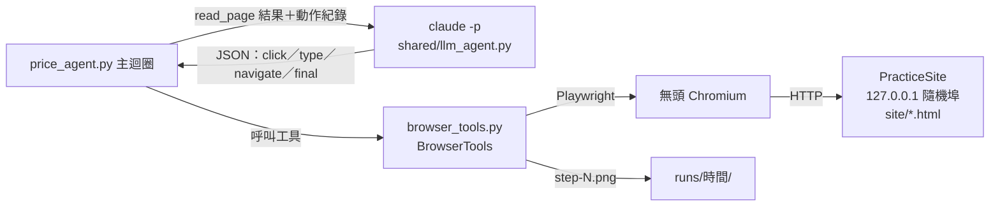

# S5 瀏覽器讀價代理 白名單網站上的瀏覽器操作

> K903《Claude Quickstarts 範例實作》第 5 段，共 5 段。對應官方 claude-quickstarts（K902）第 4～8 章 browser／computer use。
> 書號 9 開頭為自製教材，沒有原書；模型一律走 claude -p 轉接層，不設 API 金鑰。

## 導讀

S5 放在最後，因為瀏覽器與電腦操作的權限最大、風險最高。它讓模型用 navigate、read_page、click、type、screenshot 五個工具，在本機白名單練習網站上找商品價格，每一步都截圖存證。這一段要學會：怎麼用白名單限制瀏覽範圍、為什麼不登入不付款、以及有人即時看著跑（human in the loop）和無人值守的差別。

每個範例學完都要回答三個靈魂拷問：這個代理是做給誰用的？它被賦予了哪些工具的權限？它的資料和成果最後存在哪裡？

## 範例說明（README）

### 1. 模仿哪幾章、做什麼

| 官方章節 | K902 講義 |
| --- | --- |
| 第 4 章 browser-toolset | `~/workspace/kindle-902-claude-quickstarts/lessons/ch04-browser-toolset.md` |
| 第 5 章 browser-use-demo | `~/workspace/kindle-902-claude-quickstarts/lessons/ch05-browser-use-demo.md` |
| 第 6 章 computer-toolset | `~/workspace/kindle-902-claude-quickstarts/lessons/ch06-computer-toolset.md` |
| 第 7 章 computer-use-demo | `~/workspace/kindle-902-claude-quickstarts/lessons/ch07-computer-use-demo.md` |
| 第 8 章 computer-use-best-practices | `~/workspace/kindle-902-claude-quickstarts/lessons/ch08-computer-use-best-practices.md` |

一句話：代理在本機自製的「練習網購」網站上搜尋指定商品，點進商品頁，讀出最低價和賣家。模型負責看頁面並決定下一步，Playwright 無頭 Chromium 負責真的去點、去打字。

### 2. 三個靈魂拷問

| 問題 | 答案 |
| --- | --- |
| 這個代理是給誰用的？ | 只有使用者自己，在終端機看著它跑（有人即時看著）。學習用，不是無人值守的爬蟲。 |
| 被賦予了哪些工具權限？ | **給的**：`navigate`（只限白名單裡的練習網站 `127.0.0.1:<埠>`）、`read_page`、`click`、`type`、`screenshot`（只寫進 `runs/<時間>/`）。**刻意不給的**：連外網（蝦皮等真實網站會擋自動化，而且這是練習）、登入、付款、下單、送出個資、讀寫本機其他檔案、執行命令。點連結前也會檢查白名單，模型無法繞過 `navigate` 點到外站。最壞情況：模型在練習網站上亂點，或回報錯的價格。 |
| 資料和成果最後存在哪裡？ | 練習網站內容在 `site/`（虛構商品，進版控）。每次執行的截圖 `step-N.png` 與 `result.json`（目標、最終答案、模型呼叫次數）存在 `runs/<時間>/`，已被 `.gitignore` 排除，不進版控。不上傳任何地方。 |

### 3. 架構與資料流



每一步：

1. 程式讀頁面：可見文字（截斷 1500 字）＋可互動元素清單，每個元素編號 `[1]`、`[2]`…（編號寫在 `data-agent-id` 屬性上）。
2. 把「目標＋之前的動作＋目前頁面」交給 `claude -p`，模型只回一個 JSON 動作。
3. 程式執行動作、存截圖，把結果（或錯誤訊息）寫進動作紀錄，進下一步。
4. 模型回 `{"final": {...}}` 就結束；最多 8 步。

### browser toolset 和 computer use 的差別

| | browser toolset（第 4～5 章） | computer use（第 6～8 章） |
| --- | --- | --- |
| 模型看到什麼 | DOM 整理後的文字＋元素編號（`ref_N`） | 螢幕截圖（像素） |
| 怎麼指定目標 | 元素編號 | 螢幕座標 (x, y) |
| 底層 | CDP（Chrome DevTools Protocol） | VNC／作業系統滑鼠鍵盤 |
| 優點 | 便宜、準、不怕解析度 | 什麼程式都能操作，不限瀏覽器 |
| 缺點 | 只能操作網頁 | 要看圖、座標會點歪、比較慢 |

**本範例是 browser toolset 那一種**：模型只看文字和編號，`screenshot()` 只存檔給人事後對照，不交給模型看。

要改成 computer use：工具換成 `screenshot`（回傳圖片給模型看）、`left_click(x, y)`、`type(text)`（打進目前焦點）、`key("Enter")`、`scroll`、`wait`；`read_page` 和元素編號拿掉。而 `claude -p` 這條路只能傳文字，要讓模型看圖就得改成把截圖存檔、在提示詞裡請 Claude Code 用 Read 工具讀圖，或改走官方 API。

### 4. 怎麼跑（Git Bash）

```bash
cd ~/workspace/kindle-903-quickstarts-samples/s5-browser-computer

# 第一次：確認 Playwright 與 Chromium
python -c "import playwright" || python -m pip install playwright
python -m playwright install chromium

# 白名單測試（不呼叫模型）
PYTHONUTF8=1 python price_agent.py --check-allowlist

# 真實跑一次（呼叫 claude -p，最多 8 次）
PYTHONUTF8=1 python price_agent.py

# 換目標
PYTHONUTF8=1 python price_agent.py --goal "找出「NetLink GS-105 5 埠 Gigabit 交換器」的最低價和賣家"
```

練習網站由程式自己啟動在 `127.0.0.1` 的隨機埠，程式結束時一併關閉，不必另外開伺服器。想用瀏覽器自己逛：`python -m http.server 8000 --bind 127.0.0.1 --directory site`。

### 5. 實際跑出來的結果（2026-11-25 冒煙測試）

白名單測試：

```text
練習網站：http://127.0.0.1:50354/（白名單只有 127.0.0.1:50354）
已擋下：網址不在白名單，拒絕前往：https://shopee.tw/（只允許 ['127.0.0.1:50354']）
已擋下：網址不在白名單，拒絕前往：file:///C:/Windows/win.ini（只允許 ['127.0.0.1:50354']）
```

真實跑一次（約 23 秒）：

```text
練習網站：http://127.0.0.1:50364/（白名單只有 127.0.0.1:50364）
起始：已開啟 http://127.0.0.1:50364/index.html
第 1 步：{"action": "type", "element_id": 1, "text": "NetLink GS-108"} → 已在元素 1 輸入「NetLink GS-108」
第 2 步：{"action": "click", "element_id": 2} → 已點擊元素 2，目前網址 http://127.0.0.1:50364/results.html?q=NetLink+GS-108
第 3 步：{"action": "click", "element_id": 1} → 已點擊元素 1，目前網址 http://127.0.0.1:50364/product-gs108.html
第 4 步：final → {"product": "NetLink GS-108 8 埠 Gigabit 交換器", "price": "NT$ 612（免運）", "seller": "快樂3C"}

最終答案：{"product": "NetLink GS-108 8 埠 Gigabit 交換器", "price": "NT$ 612（免運）", "seller": "快樂3C"}
模型呼叫次數：4
截圖：step-1.png, step-2.png, step-3.png
```

答案正確（四家報價 689／645＋運費 60／612／730，最低是快樂3C 的 612）。

### 6. 和官方原版差在哪

| 項目 | 官方原版 | 本範例 |
| --- | --- | --- |
| 模型呼叫 | Anthropic API（要 `ANTHROPIC_API_KEY`），原生 tool use | `claude -p`（Max 訂閱），模型回 JSON 字串、程式自己解析 |
| 瀏覽器 | 第 4 章手寫 CDP WebSocket；第 5、7 章用 Docker 容器＋VNC＋Streamlit 介面 | Playwright 無頭 Chromium，在本機直接跑，不需要 Docker、VNC |
| 工具 | `browser_toolset_20260801` 一次宣告整組 | 自己定義 5 個工具，寫在系統提示裡 |
| 對話 | 多輪 messages 累積 | 每步一次全新 `claude -p`，用「動作紀錄」文字帶上下文 |
| 網站 | 真實網站（白名單 `example.com` 等） | 本機虛構練習網站 |

正式上線要改：

- 改走官方 API 的原生 tool use（工具呼叫格式由 API 保證，不用自己解析 JSON），並用 prompt caching 降低每步重送頁面的成本。
- 白名單改成可設定的網域清單，另外擋下載、擋表單送出到外站、擋 `javascript:` 連結。
- 真實網站會有登入、驗證碼、反自動化、動態載入：要加等待條件、重試、逾時與人工接手點；付款、下單等不可逆動作一律要求人確認（第 8 章 best practices）。
- 頁面文字可能藏提示詞注入：頁面內容只當資料，不當指令。
- 在隔離環境（容器或 VM）執行瀏覽器，與個人瀏覽器設定檔分開。

### 7. 模仿指南：改成自己的需求，改這 3 個地方

1. **目標**：`price_agent.py` 的 `DEFAULT_GOAL`（或執行時用 `--goal`），以及 `SYSTEM_PROMPT` 裡 `final` 的欄位（例如改成 `{"title":..., "date":...}`）。
2. **網站與白名單**：把 `site/` 換成你的練習頁面；要操作別的本機服務，就改 `main()` 傳給 `BrowserTools` 的白名單集合。
3. **工具**：在 `browser_tools.py` 的 `BrowserTools` 加方法（例如 `select(element_id, option)`、`scroll()`），再到 `run_action()` 加一個分支，並把新動作的 JSON 格式寫進 `SYSTEM_PROMPT`。

### 檔案

| 檔案 | 說明 |
| --- | --- |
| `price_agent.py` | 主迴圈：讀頁面、問模型、執行動作、印出每一步 |
| `browser_tools.py` | Playwright 工具組（navigate／read_page／click／type／screenshot）＋白名單＋練習網站伺服器 |
| `site/` | 練習網站：搜尋頁、結果列表、3 個商品詳情頁（虛構） |
| `runs/` | 執行產物（截圖、result.json），不進版控 |

## 逐步演練教練稿（8 步）

K903 範例 S5 互動演練：瀏覽器讀價代理（教練稿）

【第 1 步：這個範例對應官方哪幾章】
S5 是 K902 第四到第八章，也就是瀏覽器和電腦操作那五章的生活版。我們在自己電腦上的練習網購網站，找一台交換器的最低價和賣家。表格把五章的重點一條一條對到 S5 的檔案：第四章的元素編號和網址政策，對到工具檔的讀頁面和白名單；第五章的看、想、做迴圈，對到主程式的代理迴圈；第六、七章的截圖和座標，本範例刻意不用；第八章的步數上限和最小權限，對到最多八步、只給五個工具。最後提醒，這裡的模型走 claude -p，回的是一段文字動作，不是官方的原生工具呼叫。目的，是先知道每個概念在 S5 的哪一行。

【第 2 步：看練習網站】
第二步不呼叫模型，先看練習網站長什麼樣子。網站只有五個靜態網頁：搜尋頁、搜尋結果頁，和三個商品頁。搜尋結果是用網頁裡的小程式過濾的，所以不需要後端伺服器。接著我們自己把交換器商品頁的四家報價讀出來，最低價是快樂3C 的六百一十二元，免運。阿德電腦標價六百四十五元，再加運費六十元，更貴。目的，是先知道正確答案，第五步才判斷得了模型有沒有答對。

【第 3 步：看五個瀏覽器工具與白名單】
第三步把工具檔當純文字讀，不開瀏覽器。五個工具是：前往網址、讀頁面、點擊、輸入文字、截圖。讀頁面是重點，它會替頁面上的連結、按鈕、輸入框編號，再把可見文字和編號清單一起交給模型，所以模型只要說點第幾號就好。第二張表看白名單在哪裡生效：前往網址之前檢查一次，點連結之前也會再檢查一次，模型沒辦法用點連結的方式繞去外站。工具出錯時，錯誤訊息會原樣回給模型，讓它自己修正。目的，是看懂模型手上有哪些工具，以及白名單擋在哪裡。

【第 4 步：測試白名單】
第四步會真的啟動練習網站和無頭瀏覽器，但不呼叫模型。程式試著前往蝦皮和本機的系統檔案，兩個都應該被擋下，結束碼是零。接著再離線多測幾種網址，你會看到規則很嚴：只有練習網站那一個位址和連接埠會放行，同一台電腦的別的連接埠、本機的別名、網頁腳本連結通通被擋。目的，是在讓模型動手之前，先確認它出不了這個練習網站。

【第 5 步：實跑代理】
第五步是整個演練唯一呼叫模型的一步。實測模型呼叫四次，大約二十到三十秒，上限是八次。畫面會一步一步印出模型選的動作：先在搜尋框輸入商品名稱，再按搜尋，接著點進商品頁，最後直接回報答案。每次跑的路線可能不同，例如多讀一次頁面或先截圖，這都正常，只要最後答出快樂3C、六百一十二元就算成功。如果結束碼是二，代表八步內沒有答案；是一，代表 claude -p 呼叫失敗，要照實說明。目的，是親眼看一次模型怎麼一步一步操作瀏覽器。

【第 6 步：打開截圖與結果檔】
第六步不呼叫模型，找出最新一次有結果的執行資料夾，印出結果檔，裡面有目標、最終答案和模型呼叫次數，並且自動和第二步的正確答案比對。接著列出每一步動作後的截圖，再試著用看圖程式打開最後一張，打不開就只列檔名。要特別提醒，這些截圖只給人事後對照，模型從頭到尾沒有看過任何一張圖。目的，是學會怎麼事後檢查代理到底做了什麼。

【第 7 步：瀏覽器工具組和電腦操作的差別】
第七步不呼叫模型。對照表說明，瀏覽器工具組讓模型看文字和元素編號，便宜又準，但只能操作網頁；電腦操作讓模型看截圖、給座標，什麼程式都能操作，但比較慢，座標也可能點歪。第二張表說明要改成電腦操作時，工具怎麼換：讀頁面換成把截圖交給模型看，點擊編號換成點座標，輸入文字要先點一下輸入框，再加上按鍵、捲動和等待，網址白名單也要改到網路層去擋。最後照實說明，claude -p 只能傳文字，要讓模型看圖，就得請它用讀檔工具讀截圖，或改走官方介面。目的，是分清楚兩種做法的取捨。

【第 8 步：三個靈魂拷問】
最後是每個範例都要回答的三個問題：這個代理給誰用、被賦予哪些工具權限、資料和成果存在哪裡。每一題先請你自己想，按下輸入鍵才顯示範例答案。答案是：只有使用者自己看著它跑；只給五個工具，而且只能連練習網站，不給登入、付款、下單和連外網；網站內容進版控，截圖和結果檔留在執行資料夾，不進版控也不上傳。最後說明為什麼練習只准連本機網站：真實網站會擋自動化、頁面可能藏提示詞注入、有付款這類不可逆動作，而且價格天天變，沒辦法驗收對錯。目的，是記住讓代理操作瀏覽器之前，要先把權限和範圍想清楚。

## 主要程式碼

### s5-browser-computer/browser_tools.py

```python
"""S5 瀏覽器工具組：用 Playwright 無頭 Chromium 實作 navigate／read_page／click／type／screenshot。

模仿官方 browser-toolset（K902 第 4 章）：工具是「DOM 層」的，模型拿到的是帶編號的元素清單，
不是螢幕截圖座標。編號存在頁面的 data-agent-id 屬性上，換頁就失效，要重新 read_page。

同檔附練習網站伺服器 PracticeSite（http.server，只綁 127.0.0.1）。
"""
from __future__ import annotations

import functools
import threading
from http.server import SimpleHTTPRequestHandler, ThreadingHTTPServer
from pathlib import Path
from urllib.parse import urljoin, urlparse

from playwright.sync_api import Error as PlaywrightError
from playwright.sync_api import sync_playwright

MAX_TEXT_CHARS = 1500
# 在頁面裡替可互動元素編號；回傳編號清單給 Python
MARK_ELEMENTS_JS = """
() => {
  const sel = 'a, button, input, select, textarea';
  const out = [];
  document.querySelectorAll(sel).forEach((el) => {
    const r = el.getBoundingClientRect();
    if (r.width === 0 || r.height === 0) return;  // 隱藏的元素不給模型看
    const id = out.length + 1;
    el.setAttribute('data-agent-id', String(id));
    const label = (el.innerText || el.value || el.placeholder || el.name || '').trim();
    out.push({id, tag: el.tagName.toLowerCase(), type: el.type || '', label: label.slice(0, 60)});
  });
  return out;
}
"""


class ToolError(Exception):
    """工具執行失敗：訊息會原樣回給模型，讓它自己修正（官方範例同樣做法）。"""


class _QuietHandler(SimpleHTTPRequestHandler):
    def log_message(self, format, *args):
        # 為什麼關掉：每個請求都印一行會淹沒「第 N 步」的輸出
        return


class PracticeSite:
    """在背景執行緒啟動練習網站；port=0 讓作業系統挑空的埠，避免撞埠。"""

    def __init__(self, root: Path, port: int = 0):
        handler = functools.partial(_QuietHandler, directory=str(root))
        self.server = ThreadingHTTPServer(("127.0.0.1", port), handler)
        self.thread = threading.Thread(target=self.server.serve_forever, daemon=True)

    @property
    def base_url(self) -> str:
        host, port = self.server.server_address[:2]
        return f"http://{host}:{port}/"

    def __enter__(self) -> PracticeSite:
        self.thread.start()
        return self

    def __exit__(self, *exc) -> None:
        self.server.shutdown()
        self.server.server_close()


class BrowserTools:
    """五個瀏覽器工具。allowed_hosts 是白名單，navigate 只放行這些 host:port。"""

    def __init__(self, allowed_hosts: set[str], shot_dir: Path):
        self.allowed_hosts = allowed_hosts
        self.shot_dir = shot_dir
        self._pw = sync_playwright().start()
        self._browser = self._pw.chromium.launch(headless=True)
        self.page = self._browser.new_page(viewport={"width": 1000, "height": 700})

    def close(self) -> None:
        try:
            self._browser.close()
        finally:
            self._pw.stop()

    def check_url(self, url: str) -> None:
        """白名單政策：放行就什麼都不做，不放行就丟 ToolError（模仿官方 policy 函式）。"""
        parsed = urlparse(url)
        if parsed.scheme not in ("http", "https") or parsed.netloc not in self.allowed_hosts:
            raise ToolError(f"網址不在白名單，拒絕前往：{url}（只允許 {sorted(self.allowed_hosts)}）")

    def navigate(self, url: str) -> str:
        self.check_url(url)
        try:
            self.page.goto(url, wait_until="load", timeout=10_000)
        except PlaywrightError as exc:
            raise ToolError(f"開啟失敗：{exc}") from exc
        return f"已開啟 {self.page.url}"

    def read_page(self) -> str:
        """精簡可見文字＋編號元素清單；文字截斷避免把整頁塞給模型。"""
        elements = self.page.evaluate(MARK_ELEMENTS_JS)
        text = self.page.inner_text("body").strip()[:MAX_TEXT_CHARS]
        lines = [f"網址：{self.page.url}", f"標題：{self.page.title()}", "可見文字：", text, "可互動元素："]
        lines += [f"[{e['id']}] <{e['tag']} {e['type']}> {e['label']}" for e in elements]
        return "\n".join(lines)

    def _locate(self, element_id: int):
        loc = self.page.locator(f"[data-agent-id='{int(element_id)}']")
        if loc.count() == 0:
            raise ToolError(f"找不到元素 {element_id}，編號可能已因換頁失效，請重新 read_page")
        return loc.first

    def click(self, element_id: int) -> str:
        target = self._locate(element_id)
        href = target.get_attribute("href")
        if href:
            # 點連結前也過白名單：避免模型繞過 navigate 直接點到外站
            self.check_url(urljoin(self.page.url, href))
        target.click(timeout=5_000)
        self.page.wait_for_load_state("load")
        return f"已點擊元素 {element_id}，目前網址 {self.page.url}"

    def type(self, element_id: int, text: str) -> str:
        self._locate(element_id).fill(str(text), timeout=5_000)
        return f"已在元素 {element_id} 輸入「{text}」"

    def screenshot(self, step: int) -> str:
        path = self.shot_dir / f"step-{step}.png"
        self.page.screenshot(path=str(path))
        return str(path)
```

### s5-browser-computer/price_agent.py

```python
"""S5 瀏覽器讀價代理：模型看頁面狀態決定下一步，Playwright 執行，結果回給模型。

模仿官方 browser-use-demo（K902 第 4～5 章）的「看 → 想 → 做」迴圈，但模型走 claude -p（Max 訂閱）。
用法（在本資料夾）：
    PYTHONUTF8=1 python price_agent.py                       跑預設目標（找 GS-108 最低價）
    PYTHONUTF8=1 python price_agent.py --goal "找出 ... 最低價"
    PYTHONUTF8=1 python price_agent.py --check-allowlist     不呼叫模型，只測白名單會擋外部網址
"""
from __future__ import annotations

import argparse
import json
import sys
from datetime import datetime
from pathlib import Path

sys.path.insert(0, str(Path(__file__).resolve().parents[1] / "shared"))
from llm_agent import ask, extract_json

from browser_tools import BrowserTools, PracticeSite, ToolError

HERE = Path(__file__).resolve().parent
DEFAULT_GOAL = "找出「NetLink GS-108 8 埠 Gigabit 交換器」的最低價和賣家"
MAX_STEPS = 8
SYSTEM_PROMPT = """你是瀏覽器操作代理。每一回合你會收到目標、之前的動作紀錄、目前頁面（可見文字＋編號元素）。
你只能回一個 JSON 物件，從下列擇一：
{"action": "navigate", "url": "..."}
{"action": "read_page"}
{"action": "click", "element_id": 編號}
{"action": "type", "element_id": 編號, "text": "..."}
{"action": "screenshot"}
{"final": {"product": "...", "price": "...", "seller": "..."}}
規則：一次只做一個動作；編號只用目前頁面列出的；確定答案後立刻回 final；不要編造頁面上沒有的資料。"""


def build_prompt(goal: str, history: list[str], page_state: str, step: int) -> str:
    done = "\n".join(history) or "（尚無）"
    return f"目標：{goal}\n第 {step}/{MAX_STEPS} 步。\n之前的動作：\n{done}\n\n目前頁面：\n{page_state}"


def run_action(tools: BrowserTools, decision: dict, step: int) -> str:
    """把模型的 JSON 動作派給對應工具；工具錯誤轉成文字回給模型，不中斷迴圈。"""
    action = decision.get("action")
    try:
        if action == "navigate":
            return tools.navigate(str(decision.get("url", "")))
        if action == "read_page":
            return "已重新讀取頁面（下一步會看到最新狀態）"
        if action == "click":
            return tools.click(int(decision["element_id"]))
        if action == "type":
            return tools.type(int(decision["element_id"]), str(decision.get("text", "")))
        if action == "screenshot":
            return f"已截圖 {tools.screenshot(step)}"
        return f"錯誤：不認得的動作 {action!r}"
    except ToolError as exc:
        return f"錯誤：{exc}"
    except (KeyError, ValueError, TypeError) as exc:
        return f"錯誤：動作參數不正確（{exc}）"


def agent_loop(tools: BrowserTools, goal: str, start_url: str) -> tuple[dict | None, int]:
    """主迴圈：回傳（最終答案或 None, 模型呼叫次數）。"""
    print(f"起始：{tools.navigate(start_url)}")
    history: list[str] = []
    for step in range(1, MAX_STEPS + 1):
        reply = ask(build_prompt(goal, history, tools.read_page(), step), system=SYSTEM_PROMPT)
        try:
            decision = extract_json(reply)
        except ValueError as exc:
            history.append(f"第 {step} 步：（回覆不是 JSON）→ {exc}")
            print(history[-1])
            continue
        if "final" in decision:
            print(f"第 {step} 步：final → {json.dumps(decision['final'], ensure_ascii=False)}")
            return decision["final"], step
        result = run_action(tools, decision, step)
        tools.screenshot(step)  # 每步留一張圖，方便事後對照模型看到什麼
        history.append(f"第 {step} 步：{json.dumps(decision, ensure_ascii=False)} → {result}")
        print(history[-1])
    return None, MAX_STEPS


def check_allowlist(tools: BrowserTools) -> int:
    """不呼叫模型：確認外部網址會被白名單擋下。"""
    for url in ("https://shopee.tw/", "file:///C:/Windows/win.ini"):
        try:
            tools.navigate(url)
            print(f"失敗：{url} 沒有被擋下")
            return 1
        except ToolError as exc:
            print(f"已擋下：{exc}")
    return 0


def main() -> int:
    parser = argparse.ArgumentParser(description="S5 瀏覽器讀價代理（練習網站）")
    parser.add_argument("--goal", default=DEFAULT_GOAL)
    parser.add_argument("--check-allowlist", action="store_true")
    args = parser.parse_args()
    run_dir = HERE / "runs" / datetime.now().strftime("%Y%m%d-%H%M%S")
    run_dir.mkdir(parents=True, exist_ok=True)
    with PracticeSite(HERE / "site") as site:
        host = site.base_url.split("/")[2]
        print(f"練習網站：{site.base_url}（白名單只有 {host}）")
        tools = BrowserTools({host}, run_dir)
        try:
            if args.check_allowlist:
                return check_allowlist(tools)
            final, calls = agent_loop(tools, args.goal, site.base_url + "index.html")
        except RuntimeError as exc:  # claude -p 失敗、逾時
            print(f"錯誤：{exc}", file=sys.stderr)
            return 1
        finally:
            tools.close()
    print(f"\n最終答案：{json.dumps(final, ensure_ascii=False) if final else '（8 步內沒有答案）'}")
    print(f"模型呼叫次數：{calls}")
    print("截圖：" + ", ".join(p.name for p in sorted(run_dir.glob("*.png"))))
    (run_dir / "result.json").write_text(json.dumps({"goal": args.goal, "final": final, "model_calls": calls},
                                                     ensure_ascii=False, indent=2), encoding="utf-8")
    return 0 if final else 2


if __name__ == "__main__":
    sys.exit(main())
```
