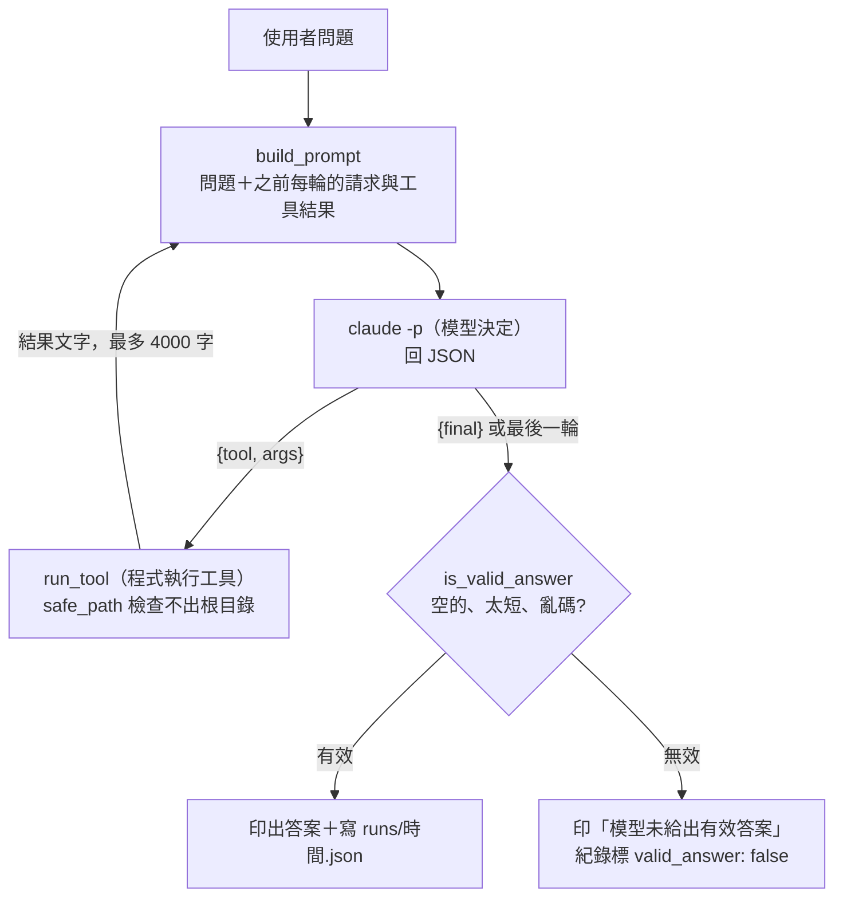

# S1 本機資料夾小管家（最小工具迴圈）

## 1. 模仿哪一章

模仿官方 claude-quickstarts 第 3 章 `agents`，講義在 `~/workspace/kindle-902-claude-quickstarts/lessons/ch03-agents.md`。

這個範例讓你在終端機用一句中文問 `~/workspace/console/shopping-notes/` 裡的比價紀錄。模型自己決定要列資料夾、搜尋關鍵字還是讀檔，讀到夠了就回答。

## 2. 三個靈魂拷問

| 問題 | 答案 |
| --- | --- |
| 這個代理是給誰用的？ | 給自己用。它查的是自己電腦上的筆記，例如「最近一次比價是什麼？推薦哪一款？」。在終端機一個人使用。 |
| 被賦予了哪些工具權限？ | **可以做的**：`list_dir`、`read_file`（最多 4000 字）、`search_text`，三個都只讀，範圍限定在一個根目錄（預設 shopping-notes，可用 `--root` 改）。路徑解析後若跑到根目錄外（`..`、`C:/Windows` 這類絕對路徑）就拒絕。<br>**刻意不給的**：寫檔、刪檔、執行指令、上網、寄信。`claude -p` 本身也用 `--tools ""` 關掉所有內建工具，所以模型只能回文字，真正動手讀檔的是我們的 Python 程式。 |
| 資料和成果最後存在哪裡？ | 答案只印在終端機。迴圈紀錄寫在 `s1-agent-loop/runs/<時間>.json`，內容有問題、答案、每一輪的請求、用了哪個工具、結果長度，**不存工具讀到的全文**。代理不寫其他任何檔案，`claude -p` 也加了 `--no-session-persistence`。 |

## 3. 架構與資料流



每次 `claude -p` 都是全新的行程，沒有記憶，所以每一輪都把「問題＋所有往來」重新攤平成一份逐字稿送進去。這就是官方 `history` 在做的事，只是這裡每次都重送全文。

## 4. 怎麼跑（Git Bash）

```bash
cd ~/workspace/kindle-903-quickstarts-samples/s1-agent-loop
PYTHONUTF8=1 python folder_agent.py "最近一次比價是什麼商品？推薦哪一款？"

# 換一個資料夾問
PYTHONUTF8=1 python folder_agent.py --root ~/workspace/console/life-notes "最近量了什麼？"
```

不需要任何 API 金鑰，前提是已經登入 Claude Code（Max 訂閱）。要換成較快的模型可以設 `K902_CLI_MODEL=haiku`。

想看「最後一輪強制作答」的行為，可以把輪數壓小：

```bash
PYTHONUTF8=1 python folder_agent.py --max-rounds 2 "shopping-notes 裡最近一次比價是什麼商品？推薦哪一款？"
```

實測（2026-11-25，2 次模型呼叫）：第 1 輪模型呼叫 `list_dir(".")`，第 2 輪給出答案，沒有把 shopping-notes 當成子資料夾。答案說明最新日期 11-25 有拉花鋼杯和鋁箔烤盤兩筆，並坦白還沒讀到推薦內容。

## 5. 實際跑出來的結果（2026-11-25 冒煙測試）

```text
第 1 輪：模型要求 list_dir({"path": "."}) → 結果 545 字，首行：2026-11-08-伯朗三合一咖啡/
第 2 輪：模型要求 list_dir({"path": "2026-11-25-latte-art-pitcher"}) → 結果 39 字，首行：original-1.jpg
第 3 輪：模型要求 read_file({"path": "2026-11-25-latte-art-pitcher/README.md", "max_chars": 3000}) → 結果 2009 字，首行：# 不鏽鋼拉花鋼杯（尖嘴奶泡杯）蝦皮 Top 5（2026-11-25）
第 4 輪：模型回覆最終答案

=== 答案 ===
最近一次比價（2026-11-25）是「不鏽鋼拉花鋼杯（尖嘴奶泡杯）」，在蝦皮比了 5 家不同店的 Top 5 ……
1. 想跟咖啡店那支最像：第 4 名「寶馬不銹鋼304拉花杯（無刻度）」，享樂生活百貨，$179～$330 ……
2. 銷量最穩又便宜：第 1 名卡特屋「304不鏽鋼拉花杯」，$69～$259 ……
另外，同一天（11-25）還有一筆「7 吋圓形鋁箔烤盤」的比價。如果你想看的是那一筆，我可以再幫你讀。

（模型呼叫 4 次，紀錄：…\s1-agent-loop\runs\20261125-141352.json）
real 0m22.1s
```

模型自己選擇先列目錄，再從日期判斷最新一筆，接著讀檔，總共 4 次呼叫。它還注意到同一天有兩筆比價，主動提醒。

錯誤處理也測過：

```text
$ PYTHONUTF8=1 python folder_agent.py --root ~/no-such-dir "測試"
錯誤：根目錄不存在或不是資料夾：%USERPROFILE%\no-such-dir      （exit 2，沒有呼叫模型）

run_tool(read_file, "../../.ssh/id_rsa") → 錯誤：拒絕存取根目錄以外的路徑：../../.ssh/id_rsa
run_tool(list_dir, "C:/Windows")         → 錯誤：拒絕存取根目錄以外的路徑：C:/Windows
```

## 6. 跟官方原版差在哪

| 項目 | 官方 `agents` | 本範例 |
| --- | --- | --- |
| 呼叫模型 | `anthropic` SDK＋`ANTHROPIC_API_KEY` | `claude -p`（shared/llm_agent.py），不設金鑰 |
| 工具協定 | API 原生 tool use（`tool_use`／`tool_result` block） | 用提示詞約定，模型回 `{"tool","args"}` 或 `{"final"}` JSON |
| 一輪幾個工具 | 可以多個，預設平行執行 | 一輪一個 |
| 結束條件 | 只有「模型不再要工具」，沒有最大輪數 | 同上，再加最多 5 輪（`--max-rounds` 可改）。最後一輪附上 `{"final": "<你的答案>"}` 範例，要求模型根據前面的工具結果作答 |
| 歷史管理 | `MessageHistory` 會依 context 上限截掉最舊的 | 每輪重送全文，工具結果每筆截到 4000 字 |
| 工具 | 本機工具＋MCP＋伺服器端工具 | 三個唯讀檔案工具，鎖在根目錄 |

正式上線要改：

- 改用 API 原生 tool use，才不會因為模型偶爾不照 JSON 格式而出錯。目前有兩道防呆。第一道：`parse_reply` 逐一嘗試回覆裡每個 `{`，取第一個含 `tool` 或 `final` 的物件，所以模型把 JSON 重複兩次也能解析。第二道：`is_valid_answer` 擋掉空答案、少於 8 字的答案、把格式說明抄回來的亂碼（實測遇過 `明、{"final":...}只輸出JSON。`）。被擋下時印出「模型未給出有效答案」，紀錄寫 `valid_answer: false` 並保留前 80 字原文，程式以 exit 3 結束。
- 每次重送全文會讓 token 越來越多，要做歷史截斷或摘要。
- 加重試與逾時處理、限制單一檔案大小。也要處理符號連結：`list_dir`／`read_file` 會先 `resolve()` 再檢查，連到根目錄外的連結會被拒絕；但 `search_text` 的 `rglob` 沒有逐檔檢查，根目錄內若有指向外面的檔案連結仍會被讀到。另外每次搜尋都要掃整個樹，資料夾大了會變慢。
- 紀錄改成結構化 log，並決定保存多久。

## 7. 模仿指南：改成自己的需求，改這 3 個地方

1. **`DEFAULT_ROOT`**：換成你想讓它管的資料夾，例如 `Path.home() / "Documents" / "食譜"`。
2. **`TOOLS` 與對應函式**：加入你需要的唯讀工具，例如 `count_files`、`read_csv_rows`。每個工具第一行都要先呼叫 `safe_path()`。
3. **`SYSTEM_PROMPT`**：改掉代理的角色和工具清單說明。新增的工具一定要寫進去，模型才知道可以用。
