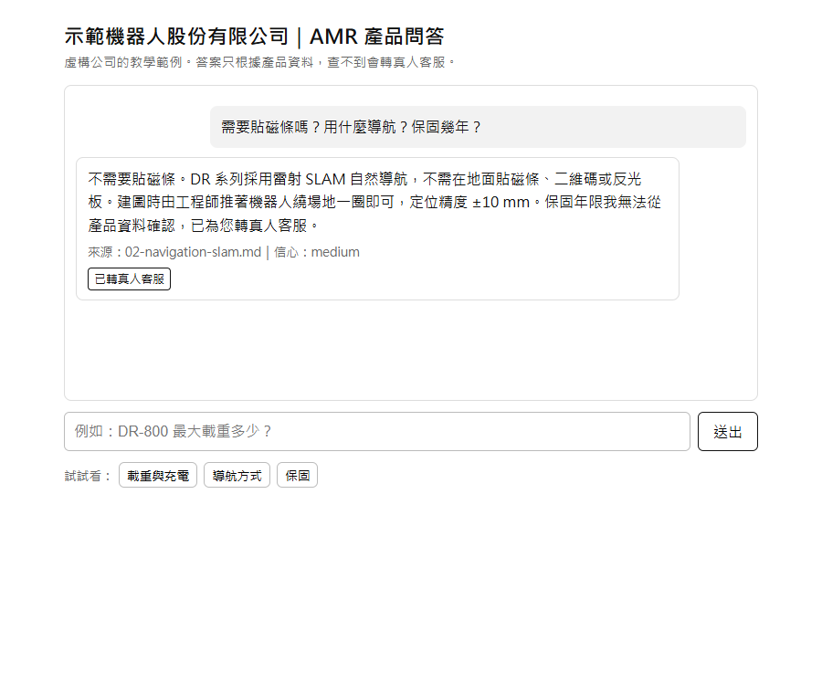

# S2 AMR 產品問答網頁

## 1. 模仿哪一章

模仿官方 `claude-quickstarts` 第 1 章 **customer-support-agent**（K902 講義：`~/workspace/kindle-902-claude-quickstarts/lessons/ch01-customer-support-agent.md`）。

一句話：虛構公司「示範機器人股份有限公司」的客服網頁，客戶在瀏覽器問 AMR 產品問題，程式先從知識庫找出最相關的 2 份文件，再請模型只根據這些文件回一個固定格式的 JSON，查不到就轉真人客服。

跟官方一樣，重點在「回覆契約」：模型每次都必須回 `{"answer", "sources", "confidence", "needs_human"}` 四個欄位，程式驗證通過才給網頁，驗證失敗就回安全的預設答案。



## 2. 三個靈魂拷問

| 題目 | 這個範例的答案 |
| --- | --- |
| 給誰用？ | **外部客戶**（想買 AMR 的工廠、倉儲人員）。這是 S1 之後第一次出現「別人」當使用者：對方可能亂問、可能故意誘導模型說出文件以外的內容、可能同時很多人在用。**所以本範例只能在自己電腦 127.0.0.1 示範。正式給客戶用時，不可以用個人 Max 訂閱加 `claude -p`**：那違反個人訂閱的使用方式，額度會被客戶吃光，也沒有穩定性保證。正式上線要改用公司的 API key，並加上速率限制與身分驗證（見第 6 節）。 |
| 被賦予哪些工具權限？ | **可以做的**：讀 `kb/` 裡的 5 份 markdown（由程式讀，不是模型讀），回一段文字。**刻意不給的**：模型沒有任何工具（`claude -p --tools ""`），不能讀檔、不能上網、不能執行指令；不能查訂單或客戶資料；不能下單、改價、承諾折扣；不能寄信。來源欄位也只保留程式真的有給它看的檔名，模型編出來的檔名會被刪掉。遇到議價、客訴、退貨，一律 `needs_human=true` 交給真人。 |
| 資料和成果存在哪？ | 知識庫：`kb/*.md`（進 git）。每次問答：`logs/YYYY-MM-DD.jsonl` 一行一筆，含問題、檢索到的文件與分數、回覆、錯誤原因、耗時（`logs/` 已在 `.gitignore`，不推上 GitHub）。**客戶的問題可能含公司名稱、聯絡方式等個資**，正式上線要訂保存期限並限制誰能讀紀錄。模型這端：`claude -p` 加了 `--no-session-persistence`，不在本機留 session 紀錄。 |

## 3. 架構與資料流

```text
瀏覽器 static/index.html
  │  POST /api/ask {"question": "..."}
  ▼
server.py（http.server，只綁 127.0.0.1:8903）
  │ ① parse_question：空字串或超過 500 字 → 400（不呼叫模型）
  │ ② retrieve：中文兩字一組（bigram）＋英數詞，算和每份 kb 文件的重疊數，取前 2 份
  │ ③ build_prompt：<docs>文件全文</docs> + 客戶問題
  ▼
shared/llm_agent.ask() ──► claude -p（系統提示走檔案、問題走 stdin、無任何工具）
  │ ④ extract_json + validate_reply：四個欄位型別檢查、來源只留真的檢索到的
  │    失敗 → SAFE_FALLBACK（轉真人）
  │ ⑤ write_log：logs/YYYY-MM-DD.jsonl
  ▼
回 JSON → 前端用 textContent 顯示答案、來源、信心、「已轉真人客服」標籤
```

對照官方：官方用 Amazon Bedrock Knowledge Bases 做檢索、Next.js 做網頁；這裡全部換成 Python 標準庫，一支 `server.py` 加一頁 HTML。

## 4. 怎麼跑（Git Bash）

```bash
cd ~/workspace/kindle-903-quickstarts-samples/s2-customer-web

# 離線自我檢查（不呼叫模型）
PYTHONUTF8=1 python server.py --selftest

# 啟動網頁，瀏覽器開 http://127.0.0.1:8903 ，Ctrl+C 結束
PYTHONUTF8=1 python server.py

# 冒煙測試：自動在背景啟動伺服器、打 3 題、測完關掉（呼叫模型 2 次）
PYTHONUTF8=1 python smoke_test.py
```

前提：已安裝並登入 Claude Code（`claude` 在 PATH 中）。**不要**設定 `ANTHROPIC_API_KEY`。要換模型可設 `K902_CLI_MODEL=haiku`。

## 5. 實際跑出來的結果

2026-11-25 冒煙測試真實輸出（完整版在 `docs/smoke-output.txt`）：

```text
S2 問答網頁啟動：http://127.0.0.1:8903（知識庫 5 份，Ctrl+C 結束）
[PASS] 知識庫內（4.2 秒）HTTP 200
       {"answer": "DR-800 最大載重為 800 公斤。充電時間方面，從 10% 充到 90% 約需 1.5 小時。另外，DR-800 支援自動充電，電量低於設定值（預設 20%）時會自行回到充電樁充電。", "sources": ["01-product-specs.md", "03-charging-battery.md"], "confidence": "high", "needs_human": false}
[PASS] 知識庫外（3.6 秒）HTTP 200
       {"answer": "這個問題我無法從產品資料確認，已為您轉真人客服。", "sources": [], "confidence": "low", "needs_human": true}
[PASS] 空字串（0.0 秒）HTTP 400
       {"error": "question 不可為空"}
結果：全部通過（模型呼叫 2 次）
```

`logs/` 裡兩筆紀錄的 `error` 都是 `null`，代表「知識庫外」那題的轉真人是模型照規則判斷的，不是解析失敗走預設回覆。

網頁截圖（上方圖片）是用 Playwright 開本機 Chrome 實際送出一題「需要貼磁條嗎？用什麼導航？保固幾年？」拍的（第 3 次模型呼叫）。這題剛好示範了一個限制：問題一次問三件事，檢索只取前 2 份，保固文件沒被選進去，所以模型答了導航、保固那部分老實說查不到並轉真人。

## 6. 跟官方原版差在哪，正式上線要改什麼

| 項目 | 官方原版 | 本範例 | 正式上線要改成 |
| --- | --- | --- | --- |
| 模型呼叫 | `@anthropic-ai/sdk`，要 `ANTHROPIC_API_KEY` | `claude -p`（個人 Max 訂閱） | **公司的 API key**（放環境變數或密鑰管理服務），不可用個人訂閱 |
| 檢索 | Amazon Bedrock Knowledge Bases（向量檢索，n=3） | 標準庫字元重疊評分，取前 2 份 | 文件一多就換向量檢索或混合檢索，並切成段落而不是整份文件 |
| 網頁 | Next.js＋shadcn/ui，左右側欄顯示思考與來源 | `http.server`＋一頁 HTML | 正式網頁框架，放在 HTTPS 反向代理後面 |
| 回覆欄位 | `response`、`thinking`、`user_mood`、`suggested_questions`、`redirect_to_agent` 等 | 只留 4 個欄位 | 依客服流程增加（例如情緒、分類） |
| JSON 驗證 | zod schema | 手寫 `validate_reply` | 用 schema 函式庫，或 API 的結構化輸出功能 |
| 轉真人 | 前端發事件 | 只顯示標籤 | 真的接客服工單或即時客服系統 |
| 防濫用 | 原型，未處理 | 只綁本機、限 500 字、限 8 KB 請求 | **速率限制**（每 IP／每帳號）、**身分驗證**、提示詞注入防護、紀錄保存期限與個資遮罩、費用上限告警 |

## 7. 模仿指南：改成自己的需求，改這 3 個地方

1. **`kb/` 換成你的文件**：每份一個主題、檔名有意義（來源欄位會直接顯示檔名）。例如改成「社區管委會 FAQ」或「公司 IT 報修說明」。
2. **`server.py` 的 `SYSTEM_PROMPT`**：改公司名稱、角色、什麼情況要轉真人（例如「涉及金額退款一律轉真人」）、回答字數。JSON 欄位若要增減，`validate_reply` 跟著改。
3. **`server.py` 的 `retrieve` 與 `TOP_K`**：文件多、問題常一次問好幾件事時，把 `TOP_K` 調大，或把文件切成小段再評分；`static/index.html` 的標題與「試試看」按鈕也順手改掉。

## 檔案清單

| 路徑 | 用途 |
| --- | --- |
| `server.py` | 伺服器：檢索、呼叫模型、驗證 JSON、寫紀錄；`--selftest` 離線檢查 |
| `static/index.html` | 聊天網頁（textContent 顯示，防 XSS） |
| `smoke_test.py` | 冒煙測試：背景啟動、3 個案例、一定關閉伺服器 |
| `kb/01～05-*.md` | 虛構知識庫：產品規格、導航與 SLAM、充電與電池、保固與維修、報價流程 |
| `docs/screenshot.png` | 網頁實際畫面 |
| `docs/smoke-output.txt` | 冒煙測試完整輸出 |
| `logs/` | 執行時產生的 JSONL 紀錄（不進 git） |
