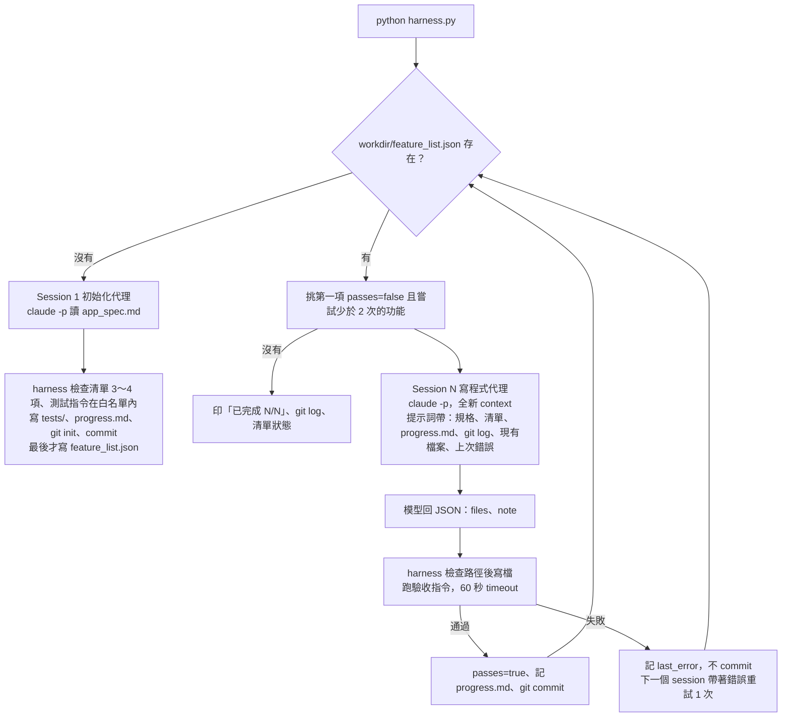

# S3　兩階段自動寫程式 harness：讓代理自己寫出「記帳 CSV 月統計 CLI」

## 1. 模仿官方哪一章

- 對應官方 `claude-quickstarts/autonomous-coding`，導讀在 K902 講義 `~/workspace/kindle-902-claude-quickstarts/lessons/ch10-autonomous-coding.md`。
- 一句話：初始化代理把 `app_spec.md` 切成 3～4 項功能並寫好驗收測試，寫程式代理每個 session 只做一項，harness 驗收、commit、記筆記，中斷後重跑同一條指令就接著做。

## 2. 三個靈魂拷問

| 問題 | 回答 |
| --- | --- |
| 這個代理是給誰用的？ | 給想學「長時間任務怎麼拆成很多個 session 接力」的自己。產出的 `ledger.py` 是給自己記帳用的小工具，不對外。 |
| 被賦予了哪些工具的權限？ | **可以做的**：回一段 JSON，寫明要寫哪些檔案、內容是什麼。寫檔、跑測試、commit 都由 harness 代做。<br>**刻意不給的**：模型本身沒有任何工具（`claude -p --tools ""`），不能自己讀檔、跑指令或上網。harness 只准寫進 `workdir/` 內，會擋 `..`、絕對路徑、`.git/`。`feature_list.json`、`progress.md` 只有 harness 能寫，模型不能改清單或把功能標成通過。寫程式代理不能改 `tests/`，所以沒辦法改測試讓自己過關。驗收指令只接受 `python -m unittest …` 或 `python <檔>.py` 兩種格式，不經過 shell，60 秒 timeout。一次執行最多呼叫模型 10 次。 |
| 資料和成果最後存在哪裡？ | 全部在 `s3-long-running/workdir/`，它是一個獨立的 git repo：`feature_list.json`（功能清單與狀態）、`progress.md`（每個 session 的交接筆記）、`tests/`、`ledger.py`，以及 git 歷史。外層 repo 的 `.gitignore` 排除 `workdir/`，所以成果不進教材的版控。 |

## 3. 架構與資料流



session 之間唯一的橋樑是 `workdir/` 裡的三樣東西：`feature_list.json` 記錄還剩哪些功能，`progress.md` 記錄上一個 session 做了什麼，git 歷史是可以回復的存檔點。這和官方原版的設計一樣。

## 4. 怎麼跑（Git Bash）

```bash
cd ~/workspace/kindle-903-quickstarts-samples/s3-long-running
PYTHONUTF8=1 python harness.py --selftest          # 離線檢查路徑與指令白名單，不呼叫模型
rm -rf workdir                                      # 想從頭來才需要
PYTHONUTF8=1 python harness.py                      # 預設跑 3 個 session，--max-calls 預設 10
PYTHONUTF8=1 python harness.py                      # 再跑一次同一條指令＝續跑
PYTHONUTF8=1 python workdir/ledger.py my.csv        # 用代理寫出來的工具
```

參數說明：`--max-sessions N` 指定這次最多跑幾個 session，`--max-calls N` 指定這次最多呼叫模型幾次，`--workdir PATH` 指定產出資料夾。模型用 Claude Code 的預設模型，要換就設 `K902_CLI_MODEL=haiku`。

## 5. 實際跑出來的結果（2026-11-25 冒煙測試，節錄）

第 1 次，從空的 workdir 開始，預設 3 個 session，約 2 分鐘：

```text
Session 1：初始化代理（讀規格 → 產出功能清單與驗收測試）
  → 功能 4 項：F1, F2, F3, F4 → commit 41e2f99
Session 2：處理功能 F1 load_records(path)：以 UTF-8 讀取 date,category,amount 格式的 CSV，…
  → 測試結果：通過 → commit b35e7bf
Session 3：處理功能 F2 sum_by_category(records) 依分類加總金額、sum_by_month(records) 依 YYYY-MM 加總金額，…
  → 測試結果：通過 → commit 78acf24

本次模型呼叫：3 次（上限 10）
== feature_list.json 狀態 ==
  F1   PASS     嘗試 1 次  load_records(path)：…
  F2   PASS     嘗試 1 次  sum_by_category(records) …
  F3   TODO     嘗試 0 次  format_report(records)：…
  F4   TODO     嘗試 0 次  CLI：執行 python ledger.py <csv 路徑> …
```

第 2 次，同一條指令，從 Session 4 接著做，約 35 秒：

```text
Session 4：處理功能 F3 format_report(records)：組出報表文字，…
  → 測試結果：通過 → commit dd919db
Session 5：處理功能 F4 CLI：執行 python ledger.py <csv 路徑> 會把報表印到 stdout，…
  → 測試結果：通過 → commit a1bc69b
沒有可做的功能了：已完成 4/4 項

本次模型呼叫：2 次（上限 10）
== git log --oneline ==
a1bc69b 完成 F4：CLI：…
dd919db 完成 F3：format_report(records)：…
78acf24 完成 F2：…
b35e7bf 完成 F1：…
41e2f99 初始化：功能清單、驗收測試、進度筆記
```

第 3 次再跑，不呼叫模型，直接印出 `沒有可做的功能了：已完成 4/4 項`。

代理寫出來的工具實際跑一次（測試資料第 5 列是故意放的壞列）：

```text
$ python workdir/ledger.py sample.csv
警告：第 5 列日期不合法，已略過：'bad'
== 各分類合計 ==
交通    35.00
餐飲    205.50
== 每月總計 ==
2026-10    155.00
2026-11    85.50
總計    240.50
```

兩次執行合計呼叫模型 5 次（初始化 1 次加上 4 項功能各 1 次），4 項功能都是第一次就通過。所以「失敗後帶錯誤重試」的路徑在這次冒煙測試中**沒有被觸發**。

## 6. 跟官方原版差在哪

| 項目 | 官方 autonomous-coding | 本範例 |
| --- | --- | --- |
| 模型怎麼呼叫 | Claude Agent SDK，要 `ANTHROPIC_API_KEY` | `claude -p`（Max 訂閱），透過 `shared/llm_agent.py`，不設任何金鑰 |
| 模型的權限 | 有 Read、Write、Bash 和 Puppeteer，靠沙箱、`./**` 權限限制和 Bash 允許清單 hook 約束 | 模型沒有任何工具，只回 JSON，寫檔和跑指令都由 harness 代做 |
| 功能清單防竄改 | 只靠提示詞（講義陷阱 2） | 清單只有 harness 能寫，模型也不能改 `tests/` |
| 何時停 | 只看 `--max-iterations`，沒有判斷全部完成（陷阱 1） | 全部通過就停；另有 `--max-calls` 呼叫上限 |
| 重試 | 出錯就開新 session，次數不限（陷阱 4） | 同一項最多重試 1 次，用完標成 GAVE-UP 並跳過 |
| 初始化寫一半被中斷 | 會被當成接續（陷阱 6） | `feature_list.json` 最後才寫，而且先寫暫存檔再改名 |
| 規模 | 200 項功能、網頁應用、瀏覽器驗證 | 4 項功能、CLI、unittest 驗證 |

**正式上線要改什麼**：

1. 驗收指令要放進真正的沙箱，例如容器或低權限帳號。目前只過白名單，被測的 Python 程式本身仍然能存取整台電腦。
2. 每個 session 要先重測已通過的功能，也就是官方第 3 步的回歸測試，否則後面的修改可能弄壞前面已通過的功能而沒人發現。
3. 專案變大後，不能再把所有檔案塞進提示詞，要改成讓模型用工具按需讀檔。目前上限 4 萬字，超過的部分會省略。
4. 初始化代理寫的測試要先由人審過一次。測試寫錯的話，後面的功能永遠過不了，或者會用錯的行為過關。
5. 失敗的修改目前留在工作區、沒有 commit。正式版應該在每次嘗試前開分支，失敗就丟掉。

## 7. 模仿指南：改成自己的需求，改這 3 個地方

1. **`app_spec.md`**：換成你要的工具規格。一定要寫清楚「介面」那一段（檔名、函式名、輸出格式），因為測試和實作是由不同的 session 寫的，靠這段對齊。
2. **`harness.py` 的 `INIT_PROMPT`，以及 `validate_features` 的 3～4 項限制**：改切分方式、功能數量、測試框架。換測試框架時，`parse_test_command` 的白名單也要一起放寬。
3. **`harness.py` 的 `CODE_PROMPT`**：改寫程式代理的規則，例如允許的套件、程式風格、交接筆記要寫什麼。
