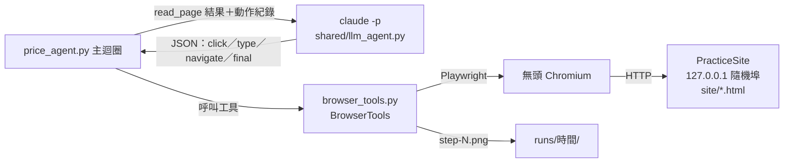

# S5 瀏覽器讀價代理（模仿官方第 4～8 章 browser／computer use）

## 1. 模仿哪幾章、做什麼

| 官方章節 | K902 講義 |
| --- | --- |
| 第 4 章 browser-toolset | `~/workspace/kindle-902-claude-quickstarts/lessons/ch04-browser-toolset.md` |
| 第 5 章 browser-use-demo | `~/workspace/kindle-902-claude-quickstarts/lessons/ch05-browser-use-demo.md` |
| 第 6 章 computer-toolset | `~/workspace/kindle-902-claude-quickstarts/lessons/ch06-computer-toolset.md` |
| 第 7 章 computer-use-demo | `~/workspace/kindle-902-claude-quickstarts/lessons/ch07-computer-use-demo.md` |
| 第 8 章 computer-use-best-practices | `~/workspace/kindle-902-claude-quickstarts/lessons/ch08-computer-use-best-practices.md` |

一句話：代理在本機自製的「練習網購」網站上搜尋指定商品，點進商品頁，讀出最低價和賣家。模型負責看頁面並決定下一步，Playwright 無頭 Chromium 負責真的去點、去打字。

## 2. 三個靈魂拷問

| 問題 | 答案 |
| --- | --- |
| 這個代理是給誰用的？ | 只有使用者自己，在終端機看著它跑（有人即時看著）。學習用，不是無人值守的爬蟲。 |
| 被賦予了哪些工具權限？ | **給的**：`navigate`（只限白名單裡的練習網站 `127.0.0.1:<埠>`）、`read_page`、`click`、`type`、`screenshot`（只寫進 `runs/<時間>/`）。**刻意不給的**：連外網（蝦皮等真實網站會擋自動化，而且這是練習）、登入、付款、下單、送出個資、讀寫本機其他檔案、執行命令。點連結前也會檢查白名單，模型無法繞過 `navigate` 點到外站。最壞情況：模型在練習網站上亂點，或回報錯的價格。 |
| 資料和成果最後存在哪裡？ | 練習網站內容在 `site/`（虛構商品，進版控）。每次執行的截圖 `step-N.png` 與 `result.json`（目標、最終答案、模型呼叫次數）存在 `runs/<時間>/`，已被 `.gitignore` 排除，不進版控。不上傳任何地方。 |

## 3. 架構與資料流



每一步：

1. 程式讀頁面：可見文字（截斷 1500 字）＋可互動元素清單，每個元素編號 `[1]`、`[2]`…（編號寫在 `data-agent-id` 屬性上）。
2. 把「目標＋之前的動作＋目前頁面」交給 `claude -p`，模型只回一個 JSON 動作。
3. 程式執行動作、存截圖，把結果（或錯誤訊息）寫進動作紀錄，進下一步。
4. 模型回 `{"final": {...}}` 就結束；最多 8 步。

### browser toolset 和 computer use 的差別

| | browser toolset（第 4～5 章） | computer use（第 6～8 章） |
| --- | --- | --- |
| 模型看到什麼 | DOM 整理後的文字＋元素編號（`ref_N`） | 螢幕截圖（像素） |
| 怎麼指定目標 | 元素編號 | 螢幕座標 (x, y) |
| 底層 | CDP（Chrome DevTools Protocol） | VNC／作業系統滑鼠鍵盤 |
| 優點 | 便宜、準、不怕解析度 | 什麼程式都能操作，不限瀏覽器 |
| 缺點 | 只能操作網頁 | 要看圖、座標會點歪、比較慢 |

**本範例是 browser toolset 那一種**：模型只看文字和編號，`screenshot()` 只存檔給人事後對照，不交給模型看。

要改成 computer use：工具換成 `screenshot`（回傳圖片給模型看）、`left_click(x, y)`、`type(text)`（打進目前焦點）、`key("Enter")`、`scroll`、`wait`；`read_page` 和元素編號拿掉。而 `claude -p` 這條路只能傳文字，要讓模型看圖就得改成把截圖存檔、在提示詞裡請 Claude Code 用 Read 工具讀圖，或改走官方 API。

## 4. 怎麼跑（Git Bash）

```bash
cd ~/workspace/kindle-903-quickstarts-samples/s5-browser-computer

# 第一次：確認 Playwright 與 Chromium
python -c "import playwright" || python -m pip install playwright
python -m playwright install chromium

# 白名單測試（不呼叫模型）
PYTHONUTF8=1 python price_agent.py --check-allowlist

# 真實跑一次（呼叫 claude -p，最多 8 次）
PYTHONUTF8=1 python price_agent.py

# 換目標
PYTHONUTF8=1 python price_agent.py --goal "找出「NetLink GS-105 5 埠 Gigabit 交換器」的最低價和賣家"
```

練習網站由程式自己啟動在 `127.0.0.1` 的隨機埠，程式結束時一併關閉，不必另外開伺服器。想用瀏覽器自己逛：`python -m http.server 8000 --bind 127.0.0.1 --directory site`。

## 5. 實際跑出來的結果（2026-11-25 冒煙測試）

白名單測試：

```text
練習網站：http://127.0.0.1:50354/（白名單只有 127.0.0.1:50354）
已擋下：網址不在白名單，拒絕前往：https://shopee.tw/（只允許 ['127.0.0.1:50354']）
已擋下：網址不在白名單，拒絕前往：file:///C:/Windows/win.ini（只允許 ['127.0.0.1:50354']）
```

真實跑一次（約 23 秒）：

```text
練習網站：http://127.0.0.1:50364/（白名單只有 127.0.0.1:50364）
起始：已開啟 http://127.0.0.1:50364/index.html
第 1 步：{"action": "type", "element_id": 1, "text": "NetLink GS-108"} → 已在元素 1 輸入「NetLink GS-108」
第 2 步：{"action": "click", "element_id": 2} → 已點擊元素 2，目前網址 http://127.0.0.1:50364/results.html?q=NetLink+GS-108
第 3 步：{"action": "click", "element_id": 1} → 已點擊元素 1，目前網址 http://127.0.0.1:50364/product-gs108.html
第 4 步：final → {"product": "NetLink GS-108 8 埠 Gigabit 交換器", "price": "NT$ 612（免運）", "seller": "快樂3C"}

最終答案：{"product": "NetLink GS-108 8 埠 Gigabit 交換器", "price": "NT$ 612（免運）", "seller": "快樂3C"}
模型呼叫次數：4
截圖：step-1.png, step-2.png, step-3.png
```

答案正確（四家報價 689／645＋運費 60／612／730，最低是快樂3C 的 612）。

## 6. 和官方原版差在哪

| 項目 | 官方原版 | 本範例 |
| --- | --- | --- |
| 模型呼叫 | Anthropic API（要 `ANTHROPIC_API_KEY`），原生 tool use | `claude -p`（Max 訂閱），模型回 JSON 字串、程式自己解析 |
| 瀏覽器 | 第 4 章手寫 CDP WebSocket；第 5、7 章用 Docker 容器＋VNC＋Streamlit 介面 | Playwright 無頭 Chromium，在本機直接跑，不需要 Docker、VNC |
| 工具 | `browser_toolset_20260801` 一次宣告整組 | 自己定義 5 個工具，寫在系統提示裡 |
| 對話 | 多輪 messages 累積 | 每步一次全新 `claude -p`，用「動作紀錄」文字帶上下文 |
| 網站 | 真實網站（白名單 `example.com` 等） | 本機虛構練習網站 |

正式上線要改：

- 改走官方 API 的原生 tool use（工具呼叫格式由 API 保證，不用自己解析 JSON），並用 prompt caching 降低每步重送頁面的成本。
- 白名單改成可設定的網域清單，另外擋下載、擋表單送出到外站、擋 `javascript:` 連結。
- 真實網站會有登入、驗證碼、反自動化、動態載入：要加等待條件、重試、逾時與人工接手點；付款、下單等不可逆動作一律要求人確認（第 8 章 best practices）。
- 頁面文字可能藏提示詞注入：頁面內容只當資料，不當指令。
- 在隔離環境（容器或 VM）執行瀏覽器，與個人瀏覽器設定檔分開。

## 7. 模仿指南：改成自己的需求，改這 3 個地方

1. **目標**：`price_agent.py` 的 `DEFAULT_GOAL`（或執行時用 `--goal`），以及 `SYSTEM_PROMPT` 裡 `final` 的欄位（例如改成 `{"title":..., "date":...}`）。
2. **網站與白名單**：把 `site/` 換成你的練習頁面；要操作別的本機服務，就改 `main()` 傳給 `BrowserTools` 的白名單集合。
3. **工具**：在 `browser_tools.py` 的 `BrowserTools` 加方法（例如 `select(element_id, option)`、`scroll()`），再到 `run_action()` 加一個分支，並把新動作的 JSON 格式寫進 `SYSTEM_PROMPT`。

## 檔案

| 檔案 | 說明 |
| --- | --- |
| `price_agent.py` | 主迴圈：讀頁面、問模型、執行動作、印出每一步 |
| `browser_tools.py` | Playwright 工具組（navigate／read_page／click／type／screenshot）＋白名單＋練習網站伺服器 |
| `site/` | 練習網站：搜尋頁、結果列表、3 個商品詳情頁（虛構） |
| `runs/` | 執行產物（截圖、result.json），不進版控 |
